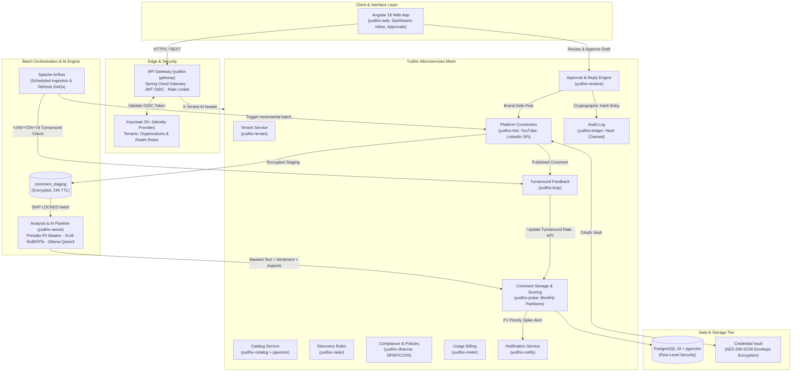
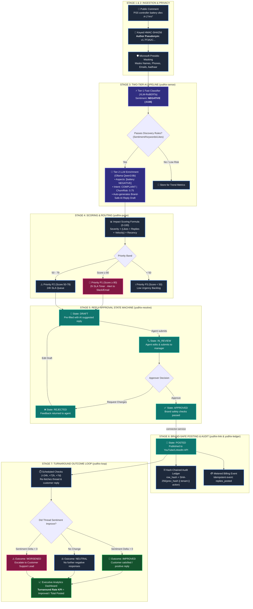
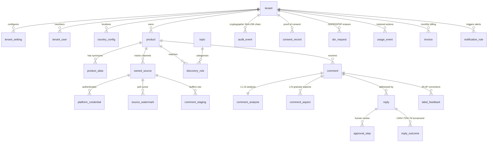
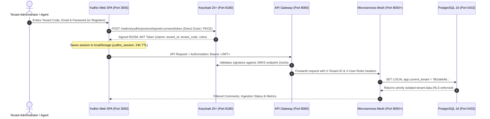

# Yudhix — Enterprise Social Comment Intelligence Platform

[](#)
[](#)
[](#)
[](#)
[](#)
[](#)
[](#)
[](#)
[](#)

---

## 1. Executive Overview & Guiding Principles

**Yudhix** is a multi-tenant, privacy-first, enterprise social comment intelligence and brand turnaround platform. It continuously harvests public comments about products from social platforms (YouTube, LinkedIn, Reddit, X), executes PII masking, extracts aspects and sentiment using local AI models (Ollama Qwen3 / XLM-RoBERTa), computes real-time impact scores, surfaces actionable insights, and orchestrates a compliant, human-in-the-loop reply turnaround workflow.

### Core Principles
- **Privacy by Design**: Store insights, not identities. Social author IDs are immediately hashed using keyed HMAC-SHA256 (`author_hash`). Personal PII is masked before model inference or long-term persistence.
- **Human-in-the-Loop**: No automated replies are ever posted without human approval (configurable 1- or 2-level approval with separation of duties).
- **Tenant Isolation**: Strict logical multi-tenancy backed by `tenant_id` on every row, Keycloak organization tokens, and PostgreSQL Row-Level Security (RLS).
- **Config over Code**: Discovery rules, SLA timers, impact weighting, and compliance policy packs (India DPDP 2023/2025, US CCPA/CPRA) are fully configuration-driven.

---

## 2. High-Level Architecture Diagram



---

## 3. End-to-End Working Flow: User Comment to Analytics & Reply

The lifecycle of a customer comment from initial creation on social media to impact calculation, human review, brand turnaround, and executive analytics:

```mermaid
sequenceDiagram
    autonumber
    actor Customer as Social Media User (YouTube / LinkedIn)
    participant Platform as Social Platform API (YouTube/LinkedIn)
    participant Airflow as Apache Airflow DAGs
    participant LinkSvc as yudhix-link (Connectors)
    participant Staging as comment_staging (Postgres)
    participant Sense as yudhix-sense (Python AI Engine)
    participant Ollama as Ollama LLM (Qwen3:8b)
    participant Pulse as yudhix-pulse (Scoring & Aggregates)
    participant Notify as yudhix-notify (Alerting)
    actor Agent as Support Agent (yudhix-web)
    actor Approver as Brand Manager / Approver
    participant Resolve as yudhix-resolve (Reply Workflow)
    participant Ledger as yudhix-ledger (Audit Trail)
    participant LoopSvc as yudhix-loop (Turnaround Tracker)

    %% 1. Ingestion
    Customer->>Platform: Posts comment ("PS5 controller battery dies in 2 hours! #fail")
    Airflow->>LinkSvc: Triggers scheduled fetch task (every 15 min / cron)
    LinkSvc->>Platform: Incremental fetchComments(since Watermark)
    Platform-->>LinkSvc: Returns raw comment, platformAuthorId, likes, replies
    Note over LinkSvc: Keyed Pseudonymization:<br/>author_hash = HMAC-SHA256(tenant_key, author_id)
    LinkSvc->>Staging: Inserts to comment_staging (encrypted text, 24h TTL)

    %% 2. Sanitization & AI Processing
    Staging->>Sense: Batch worker pulls unanalyzed staging rows
    Note over Sense: Step 1: PII Masking (Microsoft Presidio)<br/>Masks names, phones, emails, order IDs, Aadhaar
    Note over Sense: Step 2: Fast Sentiment (XLM-RoBERTa)<br/>Result: NEGATIVE (-0.84)
    Sense->>Ollama: Step 3: Deep LLM Aspect & Intent Extraction (JSON Schema)
    Ollama-->>Sense: Aspects: [battery: NEGATIVE], Intent: COMPLAINT, ChurnRisk: 0.75<br/>Suggested Reply: "We're sorry! Try updating firmware or contact..."

    %% 3. Scoring & Storage
    Sense->>Pulse: Transfers sanitized comment + sentiment + aspects + reply draft
    Note over Pulse: Computes Impact Score (0-100):<br/>Severity x (Likes + Replies + Velocity) x Recency<br/>Priority: P1 (Score: 86 >= 80)
    Pulse->>Pulse: Upserts to monthly partitioned `comment` & `comment_analysis`
    Pulse->>Notify: Emits Crisis / P1 Notification Event
    Notify-->>Agent: Sends Slack / Email Alert (2-hour SLA response countdown)

    %% 4. Human-in-the-Loop Review
    Agent->>Pulse: Views prioritized comment in yudhix-web Agent Inbox
    Agent->>Resolve: Opens AI Draft, refines response template, submits for review
    Note over Resolve: Status: DRAFT -> IN_REVIEW<br/>(Enforces separation of duties)
    Approver->>Resolve: Reviews diff in Approval Drawer and approves
    Note over Resolve: Status: APPROVED

    %% 5. Posting & Tamper-Evident Audit
    Resolve->>LinkSvc: Dispatches authorized post request
    LinkSvc->>Platform: API Call: postReply(parentId, replyText)
    Platform-->>LinkSvc: Success: returns platformReplyId
    Note over Resolve: Status: POSTED
    Resolve->>Ledger: Appends audit event
    Note over Ledger: SHA-256 Hash Chain:<br/>row_hash = SHA-256(prev_hash || tenant_id || action || payload)

    %% 6. Feedback & Turnaround Outcome Loop
    LoopSvc->>Airflow: Scheduled outcome checkpoints (+24h, +72h, +7d)
    Airflow->>LinkSvc: Re-fetch original comment thread engagement & customer replies
    LinkSvc-->>LoopSvc: Returns follow-up comments & sentiment delta
    Note over LoopSvc: Evaluates Outcome:<br/>Customer: "Thanks for the quick help, working now!"<br/>Result: IMPROVED (Turnaround Success)
    LoopSvc->>Pulse: Records turnaround outcome in daily_product_sentiment
    Agent->>Pulse: Views executive dashboard (Turnaround Rate KPI & Aspect Heatmap)
```



---

## 4. Visual Data Pipeline & Lifecycle State Machine

A step-by-step visual map showing how raw public social data is progressively enriched, prioritized, resolved, and tracked:



---

## 5. Microservices Catalog & Responsibilities

| # | Service Directory | Service Name | Tech Stack | Responsibility | Owned Tables |
|---|---|---|---|---|---|
| 1 | `services/yudhix-gateway` | **yudhix-gateway** | Spring Cloud Gateway, Java 21 | OIDC token validation, tenant route isolation, rate-limiting, CORS | *Stateless* |
| 2 | `services/yudhix-tenant` | **yudhix-tenant** | Spring Boot 3.3, Java 21 | Tenant lifecycle, settings, Keycloak org sync, multi-country configuration | `tenant`, `tenant_setting`, `tenant_user` |
| 3 | `services/yudhix-catalog` | **yudhix-catalog** | Spring Boot 3.3, Java 21, pgvector | Product catalog, aliases, competitor tracking, embeddings (bge-m3) | `product`, `product_alias`, `owned_source` |
| 4 | `services/yudhix-radar` | **yudhix-radar** | Spring Boot 3.3, Java 21 | Topic taxonomy, discovery keyword rules, sentiment & engagement filters | `discovery_rule`, `topic` |
| 5 | `services/yudhix-link` | **yudhix-link** | Spring Boot 3.3, Java 21 | Platform SPI, OAuth token vault (AES-256-GCM), watermarks, fetch & post | `platform_credential`, `source_watermark`, `comment_staging` |
| 6 | `services/yudhix-sense` | **yudhix-sense** | Python 3.11, FastAPI, Presidio | PII sanitization, fast XLM-RoBERTa classifier, Ollama LLM aspect extraction | `comment_analysis`, `comment_aspect` |
| 7 | `services/yudhix-pulse` | **yudhix-pulse** | Spring Boot 3.3, Java 21, pg_partman | Monthly partitioned comments, velocity & engagement decay, P1/P2/P3 scoring | `comment`, `daily_product_sentiment` |
| 8 | `services/yudhix-resolve` | **yudhix-resolve** | Spring Boot 3.3, Java 21 | Reply state machine (DRAFT → IN_REVIEW → APPROVED → POSTED), SLA, brand voice | `reply`, `reply_template`, `approval_step` |
| 9 | `services/yudhix-loop` | **yudhix-loop** | Spring Boot 3.3, Java 21 | +24h/+72h/+7d thread turnaround outcome measurement, agent label feedback | `reply_outcome`, `label_feedback` |
| 10 | `services/yudhix-ledger` | **yudhix-ledger** | Spring Boot 3.3, Java 21 | Append-only, SHA-256 cryptographic hash-chained audit logging, verification | `audit_event` |
| 11 | `services/yudhix-dharma` | **yudhix-dharma** | Spring Boot 3.3, Java 21 | Policy packs (DPDP 2023, CCPA), cryptographic consent records, DSR execution | `policy_document`, `consent_record`, `retention_policy`, `dsr_request` |
| 12 | `services/yudhix-meter` | **yudhix-meter** | Spring Boot 3.3, Java 21 | Idempotent usage events, plan quotas, Stripe/Razorpay invoicing, GST & US tax | `usage_event`, `plan`, `subscription`, `invoice` |
| 13 | `services/yudhix-notify` | **yudhix-notify** | Spring Boot 3.3, Java 21 | Crisis spike alerts, SLA warnings, email (Mailpit/SMTP) & Slack dispatch | `notification` |
| 14 | `services/yudhix-config` | **yudhix-config** | Spring Cloud Config | Centralized Git/file-backed application properties & tenant config profiles | *Config Store* |

### Shared Modules & Frontend
- **`libs/yudhix-common`**: Shared tenant context (`TenantContextHolder`), PostgreSQL RLS interceptors, keyed `AuthorHasher`, standard API responses (`ApiResponse<T>`, `ErrorResponse`).
- **`libs/yudhix-connector-sdk`**: Pluggable `PlatformConnector` Java SPI, `FetchRequest`, `FetchResult`, `PostResult`, `EngagementSnapshot`, `Watermark`.
- **`frontend/yudhix-web`**: Angular 18+ application with standalone components, Signals, Keycloak OIDC, and ECharts analytics.

---

## 6. Privacy, Pseudonymization & Data Lifecycle

```
[Raw Social Comment]
       │
       ▼
[Keyed HMAC-SHA256] ──► author_hash = v1.<Base64Url(HMAC(tenant_key, platform + ":" + author_id))>
       │
       ▼
[Microsoft Presidio] ──► Masks PII: <PERSON>, <PHONE>, <EMAIL>, <ORDER_ID>, <GOV_ID>
       │
       ▼
[Only Masked Text] ──► Passed to AI Models & Persisted in Monthly Partitioned DB
       │
       ▼
[Retention Policy] ──► Staging TTL: 24 Hours | Masked Text Nullified: 30 Days | Aggregates: Long-term
```

1. **Author Pseudonymization**: Rather than plain SHA-256 (which is vulnerable to dictionary attacks on public channel IDs), Yudhix uses per-tenant HMAC keys. The same person commenting on two different tenant products generates completely independent hashes.
2. **Short-Lived Staging (24h TTL)**: Raw text exists only in-memory or in an encrypted staging partition with a 24-hour time-to-live before PII scrubbing.
3. **Data Minimization & Expiration**: Masked comment text is retained for $\le 30$ days (satisfying YouTube API Developer Policies) and then set to `NULL`. Statistical aggregates (`daily_product_sentiment`) remain indefinitely for historical business intelligence.

---

## 7. Repository Directory Structure

```
yudhix/
├── pom.xml                               # Root Multi-Module Maven POM
├── mvnw / mvnw.cmd                       # Maven Wrapper Executables
├── docker-compose.yml                    # Containerized Local Dev Stack
├── README.md                             # Platform Architecture & Working Flow
├── .gitignore                            # Root Project Git Ignore
├── db/
│   └── init/
│       ├── 01-init-databases.sql         # Database provisioning (yudhix, keycloak, airflow)
│       └── 02-enable-extensions.sql      # Extensions: uuid-ossp, pgcrypto, vector
├── keycloak/
│   └── realm-yudhix.json                 # Pre-configured Realm, Clients, and Roles
├── secrets/                              # Docker secrets (git-ignored)
│   ├── pg_password.txt
│   ├── kc_admin_password.txt
│   └── master_key.txt
├── airflow/
│   └── dags/                             # Airflow Batch & Turnaround DAGs
├── libs/
│   ├── yudhix-common/                    # Shared Context, RLS, HMAC Hasher, DTOs
│   └── yudhix-connector-sdk/             # Platform Connector Java SPI
├── services/                             # Microservices Ecosystem
│   ├── yudhix-gateway/
│   ├── yudhix-tenant/
│   ├── yudhix-catalog/
│   ├── yudhix-radar/
│   ├── yudhix-link/
│   ├── yudhix-sense/
│   ├── yudhix-pulse/
│   ├── yudhix-resolve/
│   ├── yudhix-loop/
│   ├── yudhix-ledger/
│   ├── yudhix-dharma/
│   ├── yudhix-meter/
│   ├── yudhix-notify/
│   └── yudhix-config/
└── frontend/
    └── yudhix-web/                       # Angular 18 Single Page App
```

---

## 8. Getting Started (Local Development)

### Prerequisites
- **Java 21** (Temurin 21 recommended)
- **Maven 3.9+** (or use included `./mvnw`)
- **Docker & Docker Compose**
- **Python 3.11** (for `yudhix-sense`)
- **Node.js 20+ & npm** (for `yudhix-web`)

### Build Shared Modules
```bash
./mvnw clean install
```

### Start Core Infrastructure
```bash
docker compose up -d postgres keycloak ollama mailpit
```
- **PostgreSQL**: `localhost:5432` (Database: `yudhix`, User: `postgres` or `yudhix`)
- **Keycloak Admin Console**: `http://localhost:8180` (User: `admin`)
- **Mailpit Web UI**: `http://localhost:8025`
- **Ollama AI Server**: `http://localhost:11434` (Model: `llama3.1:latest`)

---

## 9. Database Architecture & Complete Table Dictionary

Yudhix utilizes **PostgreSQL 16** with a strict multi-tenant schema partitioning architecture. Every tenant-owned table is partitioned logically with `tenant_id UUID NOT NULL` as part of composite primary keys, enforcing tenant data isolation and PostgreSQL Row-Level Security (RLS).

### Entity Relationship & Data Flow Diagram



---

### Complete 31-Table Dictionary & Links

#### Group 1: Tenant & Identity Domain (`yudhix-tenant`)
| Table Name | Primary Key | Foreign Keys / Links | Usage & Business Responsibility |
|---|---|---|---|
| `tenant` | `id (UUID)` | Root Entity | Stores enterprise organizations (e.g. Sony, PlayStation). Manages tier, status, slug, and billing contact. |
| `tenant_setting` | `(tenant_id, key)` | `tenant_id` $\rightarrow$ `tenant.id` | Key-value store for tenant-specific configuration (SLA response time thresholds, default AI models, custom PII masking regex). |
| `tenant_user` | `(tenant_id, user_id)` | `tenant_id` $\rightarrow$ `tenant.id` | Maps Keycloak authentication users to internal tenant roles (`ADMIN`, `AGENT`, `APPROVER`, `COMPLIANCE`). |
| `country_config` | `(tenant_id, country_code)` | `tenant_id` $\rightarrow$ `tenant.id` | Multi-jurisdiction data privacy parameters. Governs whether India DPDP 2023 or US CCPA rules apply, and sets localized data retention limits. |

#### Group 2: Product Catalog & Source Tracking (`yudhix-catalog`)
| Table Name | Primary Key | Foreign Keys / Links | Usage & Business Responsibility |
|---|---|---|---|
| `product` | `(tenant_id, id)` | `tenant_id` $\rightarrow$ `tenant.id` | Registered brand products (e.g. "DualSense Wireless Controller", "Sony Cloud Platform"). Stores SKU and semantic vector embeddings for NLP matching. |
| `product_alias` | `(tenant_id, id)` | `product_id` $\rightarrow$ `product.id` | Alternate names, colloquial abbreviations, hashtags, and competitor comparison terms used by ingestion matching rules. |
| `owned_source` | `(tenant_id, id)` | `product_id` $\rightarrow$ `product.id` | Registered social channels (official YouTube channels, LinkedIn company pages, subreddits) subscribed for automated ingestion. |

#### Group 3: Discovery Radar & Topic Taxonomy (`yudhix-radar`)
| Table Name | Primary Key | Foreign Keys / Links | Usage & Business Responsibility |
|---|---|---|---|
| `topic` | `(tenant_id, id)` | `parent_id` $\rightarrow$ `topic.id` | Hierarchical taxonomy of customer issues (e.g. Hardware $\rightarrow$ Battery Life, Billing $\rightarrow$ API Overages). Enables categorization in the dashboard. |
| `discovery_rule` | `(tenant_id, id)` | `product_id`, `topic_id` | Keyword rules, regex patterns, sentiment thresholds, and language filters that determine which harvested comments are routed to agents. |

#### Group 4: Social Connectors & Ingestion (`yudhix-link`)
| Table Name | Primary Key | Foreign Keys / Links | Usage & Business Responsibility |
|---|---|---|---|
| `platform_credential` | `(tenant_id, platform, source_id)` | `source_id` $\rightarrow$ `owned_source.id` | Secure OAuth2 access tokens and refresh tokens encrypted with envelope AES-256-GCM. |
| `source_watermark` | `(tenant_id, source_id, platform)` | `source_id` $\rightarrow$ `owned_source.id` | High-water mark tracking for incremental polling. Remembers `last_comment_id` and timestamp so duplicate API requests are prevented. |
| `comment_staging` | `id (BIGSERIAL)` | `tenant_id` $\rightarrow$ `tenant.id` | High-throughput, short-lived ingestion buffer (24-hour TTL). Holds encrypted raw payloads before PII sanitization and sentiment inference. |

#### Group 5: Comments, AI Sentiment & Granular Aspects (`yudhix-pulse` & `yudhix-sense`)
| Table Name | Primary Key | Foreign Keys / Links | Usage & Business Responsibility |
|---|---|---|---|
| `comment` | `(tenant_id, id)` | `product_id` $\rightarrow$ `product.id`<br/>`source_id` $\rightarrow$ `owned_source.id` | Master comment record with keyed author pseudonym (`author_hash`), PII-masked text, likes, reply counts, and YouTube comment IDs. Enforces `UNIQUE(tenant_id, platform, platform_comment_id)`. |
| `comment_analysis` | `(tenant_id, comment_id)` | `comment_id` $\rightarrow$ `comment.id` | 1-to-1 AI intelligence results: fast sentiment classification, Ollama LLM intent (`COMPLAINT`, `PRAISE`), churn risk (0-1.0), impact score (0-100), priority (`P1`, `P2`, `P3`), and AI suggested turnaround reply. |
| `comment_aspect` | `id (BIGSERIAL)` | `comment_id` $\rightarrow$ `comment.id` | 1-to-Many granular aspect breakdown (e.g. `battery`: NEGATIVE, `customer-support`: NEGATIVE) with extracted text evidence and confidence scores. |
| `daily_product_sentiment` | `(tenant_id, day, product_id, platform, country_code)` | `product_id` $\rightarrow$ `product.id` | Daily pre-aggregated rollups (total positive/negative counts, engagement counts, turnaround success rates). Kept long-term for executive analytics after raw comments expire. |

#### Group 6: Reply Turnaround & Approval Workflow (`yudhix-resolve`)
| Table Name | Primary Key | Foreign Keys / Links | Usage & Business Responsibility |
|---|---|---|---|
| `reply` | `(tenant_id, id)` | `comment_id` $\rightarrow$ `comment.id`<br/>`product_id` $\rightarrow$ `product.id` | Outbound responses crafted to turn negative comments around. Tracks lifecycle state (`DRAFT` $\rightarrow$ `IN_REVIEW` $\rightarrow$ `APPROVED` $\rightarrow$ `POSTED`). |
| `reply_template` | `(tenant_id, id)` | `topic_id` $\rightarrow$ `topic.id`<br/>`product_id` $\rightarrow$ `product.id` | Approved, brand-safe message templates containing interpolation variables (e.g. `{{author}}`, `{{support_link}}`). |
| `approval_step` | `id (BIGSERIAL)` | `reply_id` $\rightarrow$ `reply.id` | Multi-tiered human-in-the-loop review log. Enforces Separation of Duties—an agent cannot approve their own drafted reply. |

#### Group 7: Feedback Loop & Turnaround Outcome (`yudhix-loop`)
| Table Name | Primary Key | Foreign Keys / Links | Usage & Business Responsibility |
|---|---|---|---|
| `reply_outcome` | `id (BIGSERIAL)` | `reply_id` $\rightarrow$ `reply.id`<br/>`comment_id` $\rightarrow$ `comment.id` | Follow-up tracking at +24h, +72h, and +7d. Measures if the customer replied, if their sentiment flipped from negative to positive, and calculates the Turnaround Success Rate. |
| `label_feedback` | `id (BIGSERIAL)` | `comment_id` $\rightarrow$ `comment.id` | RLHF audit log where human agents correct model predictions (e.g. correcting sentiment from NEUTRAL to NEGATIVE). Used for local Ollama fine-tuning datasets. |

#### Group 8: Immutable Cryptographic Ledger (`yudhix-ledger`)
| Table Name | Primary Key | Foreign Keys / Links | Usage & Business Responsibility |
|---|---|---|---|
| `audit_event` | `id (BIGSERIAL)` | `tenant_id` $\rightarrow$ `tenant.id` | Append-only, cryptographic SHA-256 hash-chained audit trail. Every ingestion, analysis, approval, and reply posts a `row_hash = SHA256(prev_hash \|\| tenant_id \|\| action \|\| payload)`. |

#### Group 9: Dharma Compliance & Privacy Framework (`yudhix-dharma`)
| Table Name | Primary Key | Foreign Keys / Links | Usage & Business Responsibility |
|---|---|---|---|
| `policy_document` | `(tenant_id, id)` | `tenant_id` $\rightarrow$ `tenant.id` | Versioned compliance declarations (India DPDP 2023, US CCPA/CPRA, GDPR) with cryptographic content checksums. |
| `consent_record` | `id (BIGSERIAL)` | `policy_id` $\rightarrow$ `policy_document.id` | Cryptographic evidence of data processing consent with timestamp and cryptographic signature. |
| `dsr_request` | `id (BIGSERIAL)` | `tenant_id` $\rightarrow$ `tenant.id` | Data Subject Request log for Right-to-Erasure (RTBF) and Data Access requests. Orchestrates zero-trace comment purging across all tables. |

#### Group 10: Usage Metering & Billing (`yudhix-meter`)
| Table Name | Primary Key | Foreign Keys / Links | Usage & Business Responsibility |
|---|---|---|---|
| `plan` | `id (VARCHAR)` | Global | Available subscription tiers (Free, Pro, Enterprise) defining monthly comment limits, active channel quotas, and API access. |
| `subscription` | `tenant_id (UUID)` | `tenant_id` $\rightarrow$ `tenant.id`<br/>`plan_id` $\rightarrow$ `plan.id` | Active billing subscription, billing cycle anchors, and current status (`ACTIVE`, `PAST_DUE`, `CANCELED`). |
| `usage_event` | `id (BIGSERIAL)` | `tenant_id` $\rightarrow$ `tenant.id` | Real-time idempotent metering log. Records billable units (`COMMENT_INGESTED`, `AI_ANALYZE_INVOCATION`, `POST_PUBLISHED`). |
| `invoice` | `id (VARCHAR)` | `tenant_id` $\rightarrow$ `tenant.id` | Monthly billing statements, payment processor IDs (Stripe/Razorpay), and tax calculation records. |

#### Group 11: Alerting & Notifications (`yudhix-notify`)
| Table Name | Primary Key | Foreign Keys / Links | Usage & Business Responsibility |
|---|---|---|---|
| `notification_rule` | `(tenant_id, id)` | `tenant_id` $\rightarrow$ `tenant.id` | Configurable alert triggers (e.g. "Trigger Slack alert if >5 P1 negative comments arrive within 15 minutes"). |
| `notification_log` | `id (BIGSERIAL)` | `rule_id` $\rightarrow$ `notification_rule.id` | History of dispatched alerts across Slack webhooks, SMTP emails, and agent dashboard banners. |

---

## 10. Database Configuration & Setup Guide

Follow these step-by-step instructions to configure, initialize, and verify the PostgreSQL database.

### Step 1: Start PostgreSQL
Ensure PostgreSQL 16+ is running locally or via Docker:
```bash
# Verify PostgreSQL is active
pg_isready -h localhost -p 5432
```

### Step 2: Create the `yudhix` Database
Create the dedicated application database:
```bash
# Create database using standard PostgreSQL CLI
createdb -h localhost -p 5432 -U postgres yudhix
```

### Step 3: Enable Required PostgreSQL Extensions
Connect to the database and enable the required extensions:
```bash
psql -h localhost -U postgres -d yudhix -c '
  CREATE EXTENSION IF NOT EXISTS "uuid-ossp";
  CREATE EXTENSION IF NOT EXISTS "pgcrypto";
'
```

### Step 4: Run Database Schema Migrations
You can execute all migrations using **Option A (Automated)** or **Option B (Manual)**:

#### Option A: One-Command Automated Setup (Recommended)
Use the included lifecycle manager script:
```bash
./yudhix.sh init-db
```
This command automatically creates the database if missing, enables `uuid-ossp` and `pgcrypto`, and applies all 11 Flyway migration scripts in correct dependency order.

#### Option B: Manual Execution Order
Execute the migration scripts sequentially:
```bash
MIGRATIONS=(
  "services/yudhix-tenant/src/main/resources/db/migration/V1__init_tenant_schema.sql"
  "services/yudhix-ledger/src/main/resources/db/migration/V1__init_ledger_schema.sql"
  "services/yudhix-dharma/src/main/resources/db/migration/V1__init_dharma_schema.sql"
  "services/yudhix-catalog/src/main/resources/db/migration/V1__init_catalog_schema.sql"
  "services/yudhix-radar/src/main/resources/db/migration/V1__init_radar_schema.sql"
  "services/yudhix-link/src/main/resources/db/migration/V1__init_link_schema.sql"
  "services/yudhix-pulse/src/main/resources/db/migration/V1__init_pulse_schema.sql"
  "services/yudhix-resolve/src/main/resources/db/migration/V1__init_resolve_schema.sql"
  "services/yudhix-loop/src/main/resources/db/migration/V1__init_loop_schema.sql"
  "services/yudhix-notify/src/main/resources/db/migration/V1__init_notify_schema.sql"
  "services/yudhix-meter/src/main/resources/db/migration/V1__init_meter_schema.sql"
)

for file in "${MIGRATIONS[@]}"; do
  echo "Applying $file..."
  psql -h localhost -U postgres -d yudhix -f "$file"
done
```

### Step 5: Verify Database Tables
Confirm that all 31 tables are created:
```bash
psql -h localhost -U postgres -d yudhix -c "\dt"
```
You should see 31 rows returned, spanning all domains.

### Step 6: Query Live Ingested Comments & AI Sentiments
Whenever you fetch live comments in the UI (`http://localhost:3000`) or via API, you can view the stored data directly in the terminal:
```bash
# View comments and granular aspects in formatted record view
./yudhix.sh db
```

Or query directly with `psql`:
```sql
SELECT 
    c.platform,
    c.platform_comment_id,
    c.masked_text,
    c.like_count,
    ca.sentiment,
    ca.priority,
    ca.impact_score,
    ca.intent,
    ca.suggested_reply
FROM comment c
LEFT JOIN comment_analysis ca ON c.id = ca.comment_id
ORDER BY c.first_seen_at DESC
LIMIT 10;
```

---

## 11. Keycloak Multi-Tenant Identity, Authentication & Setup Guide

Yudhix uses **Keycloak 25+** as its centralized OpenID Connect (OIDC) / OAuth2 Identity and Access Management (IAM) engine. In this multi-tenant SaaS architecture, every tenant operates in logical isolation while sharing unified authentication and authorization primitives.



---

### 11.1 Keycloak Realm, Roles & Client Architecture

All enterprise tenant identities reside under the dedicated **`yudhix`** realm:

| Role Name | Scope | Permissions & Capabilities |
| :--- | :--- | :--- |
| `tenant_admin` | Realm | Full control over tenant lifecycle, platform subscriptions (YouTube, LinkedIn, Reddit), user invitations, and billing. |
| `approver` | Realm | Authorized brand lead who reviews and formally approves or rejects AI-drafted turnaround replies (Separation of Duties). |
| `agent` | Realm | Frontline triage agent who monitors the Social Inbox and refines drafted responses. |
| `analyst` | Realm | Access to executive intelligence overview, sentiment velocity charts, and turnaround analytics. |
| `viewer` | Realm | Read-only access to metrics and reports. |

#### Registered Clients in `realm-yudhix.json`
* **`yudhix-web`**: Public Single Page Application (SPA) client supporting Authorization Code Flow with PKCE and Direct Access Grants (Resource Owner Password Credentials). Allowed origins: `http://localhost:3000`, `http://127.0.0.1:3000`.
* **`yudhix-gateway`**: Confidential client used by Spring Cloud Gateway (`services/yudhix-gateway`) to authenticate microservice service-to-service calls.

---

### 11.2 Authentication & Authorization Token Claims

When a user logs in, Keycloak generates a cryptographically signed RS256 JWT `access_token` with custom tenant claims:

```json
{
  "iss": "http://localhost:8180/realms/yudhix",
  "aud": "account",
  "sub": "314c7634-074a-45e1-b55e-1e1c27c8a762",
  "typ": "Bearer",
  "azp": "yudhix-web",
  "preferred_username": "admin@sony.com",
  "email": "admin@sony.com",
  "tenant_id": "9b1deb4d-3b7d-4bad-9bdd-2b0d7b3dcb6d",
  "tenant_code": "sony-playstation",
  "organization": "Sony Interactive Entertainment",
  "realm_access": {
    "roles": [
      "tenant_admin",
      "default-roles-yudhix",
      "offline_access",
      "uma_authorization"
    ]
  }
}
```

#### How Microservices Enforce Isolation:
1. **Gateway Validation**: The API Gateway validates token expiration (`exp`) and signature against `http://localhost:8180/realms/yudhix/protocol/openid-connect/certs`.
2. **Context Injection**: `TenantContextFilter` extracts `tenant_id` from claims and propagates it via the `X-Tenant-ID` header.
3. **Database RLS**: When microservices open a connection, they execute:
   ```sql
   SET LOCAL app.current_tenant = '9b1deb4d-3b7d-4bad-9bdd-2b0d7b3dcb6d';
   ```
   PostgreSQL Row-Level Security policies automatically filter out any rows belonging to other tenants.

---

### 11.3 Step-by-Step Keycloak Setup Guide

#### Step 1: Start Keycloak with Docker Compose
Keycloak is pre-configured in `docker-compose.yml`. Start the container:
```bash
docker compose up -d keycloak
```

Verify that Keycloak is running and healthy:
```bash
curl -I http://localhost:8180
# Returns HTTP/1.1 302 Found (Redirects to /admin/)
```

#### Step 2: Access Keycloak Admin Console
* **URL**: [http://localhost:8180](http://localhost:8180)
* **Master Username**: `admin`
* **Master Password**: `admin_yudhix_2026`

#### Step 3: Switch to the `yudhix` Realm
1. In the top-left dropdown (next to the Keycloak logo), switch from `master` to **`yudhix`**.
2. Verify that the realm is active and roles (`tenant_admin`, `approver`, `agent`, `analyst`) are present.

#### Step 4: Create a New Tenant User
1. Go to **Manage** $\rightarrow$ **Users** $\rightarrow$ **Add user**.
2. Set:
   * **Username**: `admin@sony.com`
   * **Email**: `admin@sony.com`
   * **Email verified**: **ON**
3. Open the **Attributes** tab and add:
   * `tenant_id`: `9b1deb4d-3b7d-4bad-9bdd-2b0d7b3dcb6d`
   * `tenant_code`: `sony-playstation`
   * `organization`: `Sony Interactive Entertainment`
4. Open the **Credentials** tab:
   * Click **Set password** $\rightarrow$ `sony_admin_2026` (Toggle **Temporary** to **OFF**).
5. Open the **Role mapping** tab:
   * Click **Assign role** $\rightarrow$ Select `tenant_admin`.

#### Step 5: Test Token Generation via Terminal
You can authenticate and inspect the live JWT directly:
```bash
curl -X POST "http://localhost:8180/realms/yudhix/protocol/openid-connect/token" \
  -d "client_id=yudhix-web" \
  -d "username=admin@sony.com" \
  -d "password=sony_admin_2026" \
  -d "grant_type=password"
```

---

### 11.4 SaaS Auth Portal & Persistent Session Management

The web application (`http://localhost:3000`) provides a centralized **SaaS Auth Portal**:

#### 1. Sign In Tab
* Allows tenant admins and agents to authenticate using their **Tenant Code**, **Work Email**, and **Password**.
* Includes a **"Maintain persistent session"** option enabled by default.
* Includes a **"Quick Fill: Sony PlayStation Demo"** button for instant one-click onboarding.

#### 2. Register New Tenant Tab (Sign Up)
* Allows new enterprise customers to register their organization.
* Fields: Company Name, auto-generated Tenant Code (kebab-case slug), Admin Full Name, Email, Password, and initial platform subscription toggles (YouTube up to 20 channels, LinkedIn, Reddit).
* Automatically provisions a new Tenant UUID, initializes quotas, and starts the workspace.

#### 3. Session Persistence Engine
* Sessions are persisted in browser `localStorage` under the key `yudhix_session` with a 24-hour expiration.
* On page refresh (`F5`), `initSession()` checks the token validity and restores tenant context without forcing re-login.
* The header and sidebar include a **Log Out** button that clears `localStorage` and smoothly returns to the Auth Portal.


