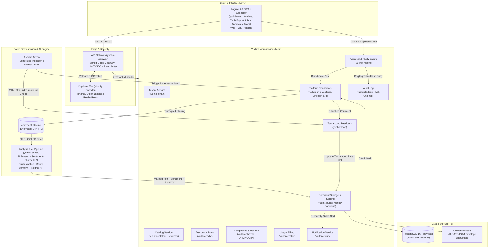
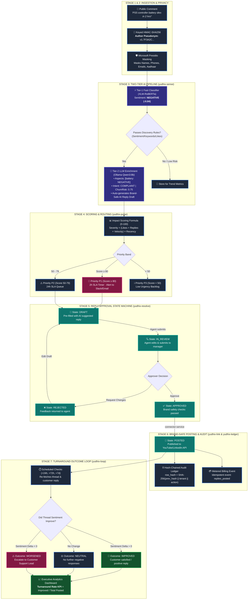
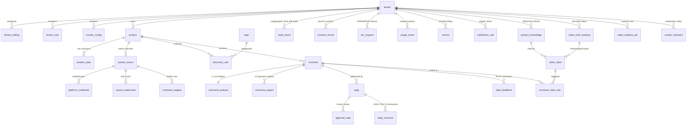
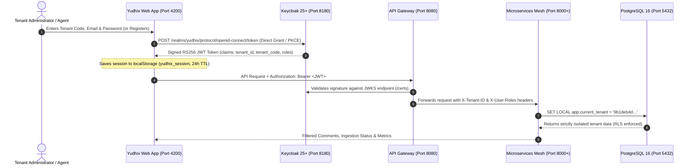

# Yudhix — Enterprise Social Comment Intelligence Platform

[](#)
[](#)
[](#)
[](#)
[](#)
[](#)
[-119eff.svg)](#)
[](#)
[](#)
[](#)

---

## 1. Executive Overview & Guiding Principles

**Yudhix** is a multi-tenant, privacy-first, enterprise social comment intelligence and brand turnaround platform. It continuously harvests public comments about products from social platforms (YouTube, LinkedIn, Reddit, X), executes PII masking, extracts aspects and sentiment using local AI models (Ollama Qwen3 / XLM-RoBERTa), computes real-time impact scores, surfaces actionable insights, and orchestrates a compliant, human-in-the-loop reply turnaround workflow.

### Truth first: the product flow

Yudhix starts with the **video**, not the comments. Before a brand replies to anyone, it should know whether the anger comes from a real product problem or from something the creator got wrong.

| Step | Screen | What happens |
|---|---|---|
| 1. **Analyze** | `/analyze` | Paste a YouTube link (or a transcript). Yudhix reads the transcript and pulls out timestamped claims. |
| 2. **Truth report** | `/videos/:id` → *Claims* | Each claim is checked against the brand's official knowledge base: *Accurate*, *Misleading*, *False* or *Unverified*, with the cited source. |
| 3. **Audience impact** | `/videos/:id` → *Audience impact* | Comments are linked to the claim that triggered them. Every comment gets a root cause: **misinformation**, **valid concern** or **general**. |
| 4. **Respond** | `/inbox`, `/approvals`, *Creator note* | Agents draft replies (AI drafts cite the official fact), approvers sign off (separation of duties), and the team sends the creator a polite clarification note. |
| 5. **Track** | `/track` | Turnaround rate, reply pipeline, SLA breaches, misinformation share and sentiment over time. |

The web app is an **Angular 20 PWA** that works on desktop, laptop, tablet and phone, and ships to the **App Store / Play Store** through **Capacitor** (see [§8.3](#83-mobile-apps-ios--android)).

### Core Principles
- **Privacy by Design**: Store insights, not identities. Social author IDs are immediately hashed using keyed HMAC-SHA256 (`author_hash`). Personal PII is masked before model inference or long-term persistence.
- **Human-in-the-Loop**: No automated replies are ever posted without human approval (configurable 1- or 2-level approval with separation of duties).
- **Tenant Isolation**: Strict logical multi-tenancy backed by `tenant_id` on every row, Keycloak organization tokens, and PostgreSQL Row-Level Security (RLS).
- **Ground Truth Triangulation (Video RAG)**: Unlike basic keyword scrapers, Yudhix decodes the **creator's video context** (Whisper transcripts + atomic claims), cross-checks them against **authoritative brand knowledge (RAG)**, and determines whether audience outrage was caused by **actual product defects** or **creator misinformation / rage-bait**.
- **Config over Code**: Discovery rules, SLA timers, impact weighting, and compliance policy packs (India DPDP 2023/2025, US CCPA/CPRA) are fully configuration-driven.

---

## 2. High-Level Architecture Diagram



---

## 3. End-to-End Working Flow: User Comment to Analytics & Reply

The lifecycle of a customer comment from initial creation on social media to impact calculation, human review, brand turnaround, and executive analytics:

```mermaid
sequenceDiagram
    autonumber
    actor Customer as Social Media User (YouTube / LinkedIn)
    participant Platform as Social Platform API (YouTube/LinkedIn)
    participant Airflow as Apache Airflow DAGs
    participant LinkSvc as yudhix-link (Connectors)
    participant Staging as comment_staging (Postgres)
    participant Sense as yudhix-sense (Python AI Engine)
    participant Ollama as Ollama LLM (Qwen3:8b)
    participant Pulse as yudhix-pulse (Scoring & Aggregates)
    participant Notify as yudhix-notify (Alerting)
    actor Agent as Support Agent (yudhix-web)
    actor Approver as Brand Manager / Approver
    participant Resolve as yudhix-resolve (Reply Workflow)
    participant Ledger as yudhix-ledger (Audit Trail)
    participant LoopSvc as yudhix-loop (Turnaround Tracker)

    %% 1. Ingestion
    Customer->>Platform: Posts comment ("PS5 controller battery dies in 2 hours! #fail")
    Airflow->>LinkSvc: Triggers scheduled fetch task (every 15 min / cron)
    LinkSvc->>Platform: Incremental fetchComments(since Watermark)
    Platform-->>LinkSvc: Returns raw comment, platformAuthorId, likes, replies
    Note over LinkSvc: Keyed Pseudonymization:<br/>author_hash = HMAC-SHA256(tenant_key, author_id)
    LinkSvc->>Staging: Inserts to comment_staging (encrypted text, 24h TTL)

    %% 2. Sanitization & AI Processing
    Staging->>Sense: Batch worker pulls unanalyzed staging rows
    Note over Sense: Step 1: PII Masking (Microsoft Presidio)<br/>Masks names, phones, emails, order IDs, Aadhaar
    Note over Sense: Step 2: Fast Sentiment (XLM-RoBERTa)<br/>Result: NEGATIVE (-0.84)
    Sense->>Ollama: Step 3: Deep LLM Aspect & Intent Extraction (JSON Schema)
    Ollama-->>Sense: Aspects: [battery: NEGATIVE], Intent: COMPLAINT, ChurnRisk: 0.75<br/>Suggested Reply: "We're sorry! Try updating firmware or contact..."

    %% 3. Scoring & Storage
    Sense->>Pulse: Transfers sanitized comment + sentiment + aspects + reply draft
    Note over Pulse: Computes Impact Score (0-100):<br/>Severity x (Likes + Replies + Velocity) x Recency<br/>Priority: P1 (Score: 86 >= 80)
    Pulse->>Pulse: Upserts to monthly partitioned `comment` & `comment_analysis`
    Pulse->>Notify: Emits Crisis / P1 Notification Event
    Notify-->>Agent: Sends Slack / Email Alert (2-hour SLA response countdown)

    %% 4. Human-in-the-Loop Review
    Agent->>Pulse: Views prioritized comment in yudhix-web Agent Inbox
    Agent->>Resolve: Opens AI Draft, refines response template, submits for review
    Note over Resolve: Status: DRAFT -> IN_REVIEW<br/>(Enforces separation of duties)
    Approver->>Resolve: Reviews diff in Approval Drawer and approves
    Note over Resolve: Status: APPROVED

    %% 5. Posting & Tamper-Evident Audit
    Resolve->>LinkSvc: Dispatches authorized post request
    LinkSvc->>Platform: API Call: postReply(parentId, replyText)
    Platform-->>LinkSvc: Success: returns platformReplyId
    Note over Resolve: Status: POSTED
    Resolve->>Ledger: Appends audit event
    Note over Ledger: SHA-256 Hash Chain:<br/>row_hash = SHA-256(prev_hash || tenant_id || action || payload)

    %% 6. Feedback & Turnaround Outcome Loop
    LoopSvc->>Airflow: Scheduled outcome checkpoints (+24h, +72h, +7d)
    Airflow->>LinkSvc: Re-fetch original comment thread engagement & customer replies
    LinkSvc-->>LoopSvc: Returns follow-up comments & sentiment delta
    Note over LoopSvc: Evaluates Outcome:<br/>Customer: "Thanks for the quick help, working now!"<br/>Result: IMPROVED (Turnaround Success)
    LoopSvc->>Pulse: Records turnaround outcome in daily_product_sentiment
    Agent->>Pulse: Views executive dashboard (Turnaround Rate KPI & Aspect Heatmap)
```



---

## 4. Visual Data Pipeline & Lifecycle State Machine

A step-by-step visual map showing how raw public social data is progressively enriched, prioritized, resolved, and tracked:



---

## 4.1 Ground Truth Triangulation: Influencer Video Decoding & RAG Fact-Check Engine

A major architectural innovation of Yudhix is **Ground Truth Triangulation**. Unlike legacy monitoring tools that evaluate customer comments in a vacuum, Yudhix decodes the video narrative, verifies claims against official brand records, and links audience outrage to its root cause:

```
               ┌────────────────────────────────────────────────────────┐
               │              OFFICIAL BRAND KNOWLEDGE RAG              │
               │   (Sony Hardware Specs, EULAs, Discs Policy, Warranties)│
               └───────────────────────────┬────────────────────────────┘
                                           │ Semantic Cross-Encoder
                                           ▼
┌──────────────────────────────┐          ┌─────────────────────────────┐
│  INFLUENCER VIDEO ANALYSIS   │ ───────► │    RAG FACT-CHECK MATRIX    │
│  • Whisper Speech-to-Text    │          │  • Verified True            │
│  • Atomic Chronological Quote│          │  • Misleading / False       │
│  • Sensationalism / Rage-Bait│          │  • Unverified Speculation   │
└──────────────────────────────┘          └──────────────┬──────────────┘
                                                         │
                                                         ▼
                                          ┌─────────────────────────────┐
                                          │  CAUSALITY OUTRAGE MAPPING  │
                                          │  • 86.4% boycott comments   │
                                          │    triggered by Claim @01:14│
                                          │  • Action: Creator Outreach │
                                          └─────────────────────────────┘
```

### Triangulation Capabilities
1. **Atomic Claim Extraction**: Automatically identifies and timestamps key statements made in YouTube videos (e.g., *"Sony is revoking offline disc playability with a mandatory patch"*).
2. **Product Knowledge RAG**: Semantically matches creator assertions against authoritative product engineering specs (`product_knowledge` table in PostgreSQL).
3. **Automated Claim Verdicts**: Emits structured confidence scores, official document citations (e.g. *Section 4.2: Media Drive Verification*), and verdicts (`MISLEADING`, `UNVERIFIED_SPECULATION`, `FACTUALLY_CORRECT`).
4. **Causality & Anger Attribution**: Proves to brand executives that public backlash was triggered by *creator misinformation* rather than a failure of the product itself.
5. **Creator Clarification Kit**: Generates personalized, polite outreach notes citing official specifications so creators can update pinned comments and avoid viral PR crises.

### How it is implemented (`services/yudhix-sense/app/truth`)

"Analyze a video" runs as a background job (`video_analysis_job`). The UI polls it and shows each stage:

| Stage | Module | What it does | Fallback when the optional piece is missing |
|---|---|---|---|
| `FETCHING_VIDEO` | `youtube.py` | Title, channel, duration, views (YouTube Data API) | YouTube oEmbed (no key needed) |
| `TRANSCRIBING` | `youtube.py` | YouTube captions (`youtube-transcript-api`) → Whisper (`faster-whisper` + `yt-dlp`) | Pasted transcript (`[mm:ss] text` lines) |
| `EXTRACTING_CLAIMS` | `claims.py` | Local LLM extracts up to 8 atomic, timestamped claims | Rule-based: assertive sentences (numbers, prices, absolutes, policy verbs, brand terms) |
| `FACT_CHECKING` | `retrieval.py`, `verifier.py` | BM25 retrieval over `product_knowledge`, then a verdict per claim | Rule-based: matching figures, absolutes the source negates, predictions → unverified |
| `INGESTING_COMMENTS` | `pipeline.py` | Pulls comments, masks PII, pseudonymizes authors (keyed HMAC), classifies sentiment | Uses comments already stored for the video |
| `ATTRIBUTING` | `attribution.py`, `scoring.py` | Links each comment to the claim it reacts to, sets root cause, re-scores impact and priority | – |

**Verdicts.** Small local models are unreliable at choosing a verdict label directly. The LLM therefore states how the source *relates* to the claim (`SUPPORTS`, `CONTRADICTS`, `PARTIALLY_CONTRADICTS`, `NOT_ADDRESSED`, plus `is_prediction`), and code maps that to a verdict. A guardrail downgrades "supports" to *Misleading* when the claim states an absolute that the source explicitly qualifies. Each claim records whether it was checked by `LLM`, `HEURISTIC` or was `SEEDED`, and the UI shows that next to its confidence.

**Attribution** is deterministic and explainable:
- A comment links to at most one claim: the claim it shares the most specific words with (IDF-weighted, with a small concept thesaurus, e.g. *disc ↔ physical ↔ blu-ray*).
- Brand words and everyday words are down-weighted. At least one specific word from the claim itself must match.
- A comment that mentions a timestamp near a claim ("at 1:14…") links directly.
- The matched words are stored in `comment_claim_link.evidence` and shown in the UI as "Why linked".

**Root cause** per comment: `MISINFORMATION` (reacts to a misleading, false or unverified claim), `VALID_CONCERN` (reacts to an accurate claim), or `UNLINKED`.

**Impact score** (0–100) = `100 × severity^0.8 × engagement × recency`, plus 10% for misinformation-driven comments. P1 ≥ 80, P2 ≥ 50, else P3. Calibrated so that a fresh negative comment with ~100 likes is P1, the same comment a month later is P2, and an unliked complaint is P3.

---

## 5. Microservices Catalog & Responsibilities

| # | Service Directory | Service Name | Tech Stack | Responsibility | Owned Tables |
|---|---|---|---|---|---|
| 1 | `services/yudhix-gateway` | **yudhix-gateway** | Spring Cloud Gateway, Java 21 | OIDC token validation, tenant route isolation, rate-limiting, CORS | *Stateless* |
| 2 | `services/yudhix-tenant` | **yudhix-tenant** | Spring Boot 3.3, Java 21 | Tenant lifecycle, settings, Keycloak org sync, multi-country configuration | `tenant`, `tenant_setting`, `tenant_user` |
| 3 | `services/yudhix-catalog` | **yudhix-catalog** | Spring Boot 3.3, Java 21, pgvector | Product catalog, aliases, competitor tracking, embeddings (bge-m3) | `product`, `product_alias`, `owned_source` |
| 4 | `services/yudhix-radar` | **yudhix-radar** | Spring Boot 3.3, Java 21 | Topic taxonomy, discovery keyword rules, sentiment & engagement filters | `discovery_rule`, `topic` |
| 5 | `services/yudhix-link` | **yudhix-link** | Spring Boot 3.3, Java 21 | Platform SPI, OAuth token vault (AES-256-GCM), watermarks, fetch & post | `platform_credential`, `source_watermark`, `comment_staging` |
| 6 | `services/yudhix-sense` | **yudhix-sense** | Python 3.11+, FastAPI, Ollama | PII masking, sentiment, LLM enrichment. **Today it also hosts the truth-first core** (video analysis jobs, claims, fact-checking, attribution, creator notes) and the **Respond & Track API** (inbox, reply approvals, outcomes, insights) that the web app uses. These move to `yudhix-resolve` / `yudhix-loop` as those services mature. | `comment_analysis`, `comment_aspect`, `product_knowledge`, `video_truth_analysis`, `video_claim`, `video_analysis_job`, `comment_claim_link`, `creator_outreach` |
| 7 | `services/yudhix-pulse` | **yudhix-pulse** | Spring Boot 3.3, Java 21, pg_partman | Monthly partitioned comments, velocity & engagement decay, P1/P2/P3 scoring | `comment`, `daily_product_sentiment` |
| 8 | `services/yudhix-resolve` | **yudhix-resolve** | Spring Boot 3.3, Java 21 | Reply state machine (DRAFT → IN_REVIEW → APPROVED → POSTED), SLA, brand voice | `reply`, `reply_template`, `approval_step` |
| 9 | `services/yudhix-loop` | **yudhix-loop** | Spring Boot 3.3, Java 21 | +24h/+72h/+7d thread turnaround outcome measurement, agent label feedback | `reply_outcome`, `label_feedback` |
| 10 | `services/yudhix-ledger` | **yudhix-ledger** | Spring Boot 3.3, Java 21 | Append-only, SHA-256 cryptographic hash-chained audit logging, verification | `audit_event` |
| 11 | `services/yudhix-dharma` | **yudhix-dharma** | Spring Boot 3.3, Java 21 | Policy packs (DPDP 2023, CCPA), cryptographic consent records, DSR execution | `policy_document`, `consent_record`, `retention_policy`, `dsr_request` |
| 12 | `services/yudhix-meter` | **yudhix-meter** | Spring Boot 3.3, Java 21 | Idempotent usage events, plan quotas, Stripe/Razorpay invoicing, GST & US tax | `usage_event`, `plan`, `subscription`, `invoice` |
| 13 | `services/yudhix-notify` | **yudhix-notify** | Spring Boot 3.3, Java 21 | Crisis spike alerts, SLA warnings, email (Mailpit/SMTP) & Slack dispatch | `notification` |
| 14 | `services/yudhix-config` | **yudhix-config** | Spring Cloud Config | Centralized Git/file-backed application properties & tenant config profiles | *Config Store* |

### Shared Modules & Frontend
- **`libs/yudhix-common`**: Shared tenant context (`TenantContextHolder`), PostgreSQL RLS interceptors, keyed `AuthorHasher`, standard API responses (`ApiResponse<T>`, `ErrorResponse`).
- **`libs/yudhix-connector-sdk`**: Pluggable `PlatformConnector` Java SPI, `FetchRequest`, `FetchResult`, `PostResult`, `EngagementSnapshot`, `Watermark`.
- **`frontend/yudhix-web`**: Angular 20 app (standalone components, signals, lazy-loaded pages) that is also a PWA (installable, offline shell) and a Capacitor 8 project for iOS / Android. Responsive layout: sidebar on desktop, icon rail on tablet, top bar + bottom tabs on phones, with light/dark themes and safe-area support. No UI library: a small design system lives in `src/styles.scss`, and charts are hand-built SVG.

---

## 6. Privacy, Pseudonymization & Data Lifecycle

```
[Raw Social Comment]
       │
       ▼
[Keyed HMAC-SHA256] ──► author_hash = v1.<Base64Url(HMAC(tenant_key, platform + ":" + author_id))>
       │
       ▼
[Microsoft Presidio] ──► Masks PII: <PERSON>, <PHONE>, <EMAIL>, <ORDER_ID>, <GOV_ID>
       │
       ▼
[Only Masked Text] ──► Passed to AI Models & Persisted in Monthly Partitioned DB
       │
       ▼
[Retention Policy] ──► Staging TTL: 24 Hours | Masked Text Nullified: 30 Days | Aggregates: Long-term
```

1. **Author Pseudonymization**: Rather than plain SHA-256 (which is vulnerable to dictionary attacks on public channel IDs), Yudhix uses per-tenant HMAC keys. The same person commenting on two different tenant products generates completely independent hashes.
2. **Short-Lived Staging (24h TTL)**: Raw text exists only in-memory or in an encrypted staging partition with a 24-hour time-to-live before PII scrubbing.
3. **Data Minimization & Expiration**: Masked comment text is retained for $\le 30$ days (satisfying YouTube API Developer Policies) and then set to `NULL`. Statistical aggregates (`daily_product_sentiment`) remain indefinitely for historical business intelligence.

---

## 7. Repository Directory Structure

```
yudhix/
├── pom.xml                               # Root Multi-Module Maven POM
├── mvnw / mvnw.cmd                       # Maven Wrapper Executables
├── docker-compose.yml                    # Containerized Local Dev Stack
├── README.md                             # Platform Architecture & Working Flow
├── .gitignore                            # Root Project Git Ignore
├── db/
│   └── init/
│       ├── 01-init-databases.sql         # Database provisioning (yudhix, keycloak, airflow)
│       └── 02-enable-extensions.sql      # Extensions: uuid-ossp, pgcrypto, vector
├── keycloak/
│   └── realm-yudhix.json                 # Pre-configured Realm, Clients, and Roles
├── secrets/                              # Docker secrets (git-ignored)
│   ├── pg_password.txt
│   ├── kc_admin_password.txt
│   └── master_key.txt
├── airflow/
│   └── dags/                             # Airflow Batch & Turnaround DAGs
├── libs/
│   ├── yudhix-common/                    # Shared Context, RLS, HMAC Hasher, DTOs
│   └── yudhix-connector-sdk/             # Platform Connector Java SPI
├── services/                             # Microservices Ecosystem
│   ├── yudhix-gateway/
│   ├── yudhix-tenant/
│   ├── yudhix-catalog/
│   ├── yudhix-radar/
│   ├── yudhix-link/
│   ├── yudhix-sense/
│   ├── yudhix-pulse/
│   ├── yudhix-resolve/
│   ├── yudhix-loop/
│   ├── yudhix-ledger/
│   ├── yudhix-dharma/
│   ├── yudhix-meter/
│   ├── yudhix-notify/
│   └── yudhix-config/
└── frontend/
    └── yudhix-web/                       # Angular 20 PWA + Capacitor (web, iOS, Android)
```

#### `services/yudhix-sense` (Python API used by the web app)
```
app/
├── main.py                 # FastAPI app: CORS, startup migrations, /health capabilities, legacy endpoints
├── db.py                   # Comment persistence helpers
├── core/                   # config (env vars), database (cursor, migrations, hash-chained audit), llm (Ollama), text
├── migrations/V2__truth_first.sql   # Idempotent; applied on every startup
├── pipeline/               # PII masker, keyword sentiment classifier, LLM enricher
├── truth/                  # youtube, claims, retrieval, verifier, attribution, scoring, outreach, pipeline (job), repository
├── workflow/               # state (approval state machine), service (inbox, replies, outcomes), insights (KPIs)
└── api/                    # deps (tenant + actor headers), truth routes, workflow routes
tests/                      # pytest: masker, classifier, truth core, state machine
```

#### `frontend/yudhix-web`
```
src/
├── styles.scss             # Design system: tokens (light/dark), buttons, chips, cards, sheets, skeletons
├── environments/           # apiUrl + tenant per build (prod used for store builds)
└── app/
    ├── core/               # api.service (typed client + header interceptor), models, session (role/theme), native (Capacitor)
    ├── shared/             # icon set, verdict badge, score ring, sentiment bar, toasts, pipes
    ├── layout/             # shell: sidebar / rail / bottom tabs
    └── features/
        ├── analyze/        # Step 1: paste a video, live job progress
        ├── videos/         # Video list + Truth report (Claims · Audience impact · Creator note)
        ├── inbox/          # Prioritized comments, root cause, AI-drafted replies
        ├── approvals/      # Review lanes, approve / request changes, post, record outcome
        ├── track/          # KPIs, outcomes, pipeline, sentiment trend, per-video accuracy
        └── knowledge/      # Official facts used for fact-checking
capacitor.config.ts         # appId io.yudhix.app, webDir dist/yudhix-web/browser
```

---

## 8. Getting Started (Local Development)

### Prerequisites
- **Java 21** (Temurin 21 recommended)
- **Maven 3.9+** (or use included `./mvnw`)
- **Docker & Docker Compose**
- **Python 3.11+** (for `yudhix-sense`)
- **Node.js 20.19+ / 22+ & npm** (for `yudhix-web`, Angular 20)

### Build Shared Modules
```bash
./mvnw clean install
```

### Start Core Infrastructure
```bash
docker compose up -d postgres keycloak ollama mailpit
```
- **PostgreSQL**: `localhost:5432` (Database: `yudhix`, User: `postgres` or `yudhix`)
- **Keycloak Admin Console**: `http://localhost:8180` (User: `admin`)
- **Mailpit Web UI**: `http://localhost:8025`
- **Ollama AI Server**: `http://localhost:11434` (Model: `llama3.1:latest`)

### 8.1 Run the app

```bash
./yudhix.sh start        # Ollama check, yudhix-sense on :8000, yudhix-web on :4200
./yudhix.sh status
./yudhix.sh stop
```

Or run the two parts yourself:

```bash
# API (applies migrations/V2__truth_first.sql on startup)
cd services/yudhix-sense
python3 -m venv .venv && ./.venv/bin/pip install -r requirements.txt
./.venv/bin/uvicorn app.main:app --port 8000 --reload

# Web app
cd frontend/yudhix-web
npm install
npm start                # http://localhost:4200
```

Open **http://localhost:4200**. The app opens on **Analyze**. Try the example video, or open **Videos → "PlayStation Explains Why it's Ending Physical Discs"** to see a full truth report built from 2,662 stored comments.

**Demo roles.** Until the SaaS/auth layer ships, the avatar in the sidebar (or top bar on phones) switches between **Asha (agent)** and **Ravi (approver)**. The app sends `X-User-Id` / `X-User-Role` headers, and the API enforces separation of duties: nobody can approve a reply they wrote.

### 8.2 Configuration (`yudhix-sense` environment variables)

| Variable | Default | Purpose |
|---|---|---|
| `YOUTUBE_API_KEY` | *(empty)* | Pull metadata and comments for newly analyzed videos. Without it, analysis uses oEmbed metadata and only the comments already stored. **Server-side only, never put it in the web app.** |
| `OLLAMA_URL` / `OLLAMA_MODEL` | `http://127.0.0.1:11434` / `llama3.1:latest` | Local LLM for claim extraction, fact-checking and reply drafts. Without it, rule-based fallbacks are used, and the app shows which mode it's in. |
| `WHISPER_MODEL` | `small` | Used only if `faster-whisper` is installed and `yt-dlp` is on `PATH` (videos without captions). |
| `AUTHOR_HMAC_KEY` | `dev-only-change-me` | Secret for pseudonymizing comment authors. **Set a strong value in production.** |
| `MAX_COMMENTS_PER_VIDEO` | `500` | Comments pulled per analysis. |
| `CORS_ORIGINS` | `localhost:4200`, `capacitor://localhost`, … | Allowed web/app origins. |
| `PG_HOST` / `PG_PORT` / `PG_DB` / `PG_USER` / `PG_PASSWORD` | `localhost` / `5432` / `yudhix` / `postgres` / `postgres` | Database. |

`GET /health` reports which optional capabilities are active (`llm`, `youtubeApi`, `captions`, `whisper`, `livePosting`). The Analyze screen shows them as chips.

### 8.3 Mobile apps (iOS & Android)

The same Angular build ships to the stores through Capacitor 8 (`capacitor.config.ts`, app id `io.yudhix.app`). The native projects aren't committed yet. Create them once on a machine with Xcode / Android Studio:

```bash
cd frontend/yudhix-web
# 1. Point the app at a reachable API (a phone can't reach "localhost" on your laptop)
#    edit src/environments/environment.prod.ts → apiUrl: 'https://api.your-domain.com'
npx cap add ios          # creates ios/ (commit it)
npx cap add android      # creates android/ (commit it)
npm run mobile:sync      # ng build + cap sync
npm run mobile:ios       # opens Xcode → run on a simulator / archive for App Store
npm run mobile:android   # opens Android Studio → run / build a signed bundle for Play Store
```

Already handled in the web code: safe-area insets (notch / home indicator), status bar style, splash screen, the Android back button (`src/app/core/native.ts`), touch-sized targets, bottom-tab navigation and bottom sheets on phones. Add `capacitor://localhost` (iOS) and `http://localhost` (Android) to `CORS_ORIGINS` on the production API. They're already in the defaults and in the Keycloak realm.

Before submitting to the stores you still need app icons and splash images (`npx @capacitor/assets generate`), store listings, a privacy policy URL, and the production API + auth.

### 8.4 Tests

```bash
./yudhix.sh unit                                   # both suites
cd services/yudhix-sense && ./.venv/bin/python -m pytest -q tests     # 20 backend tests
cd frontend/yudhix-web && npm test                                    # 7 frontend tests (headless Chrome)
```

Backend tests cover video-link parsing, transcript parsing, the rule-based verifier, claim extraction, attribution and root cause, impact scoring bands, and the approval state machine (including separation of duties).

---

## 9. Database Architecture & Complete Table Dictionary

Yudhix utilizes **PostgreSQL 16** with a strict multi-tenant schema partitioning architecture. Every tenant-owned table is partitioned logically with `tenant_id UUID NOT NULL` as part of composite primary keys, enforcing tenant data isolation and PostgreSQL Row-Level Security (RLS).

### Entity Relationship & Data Flow Diagram



---

### Complete 37-Table Dictionary & Links

#### Group 1: Tenant & Identity Domain (`yudhix-tenant`)
| Table Name | Primary Key | Foreign Keys / Links | Usage & Business Responsibility |
|---|---|---|---|
| `tenant` | `id (UUID)` | Root Entity | Stores enterprise organizations (e.g. Sony, PlayStation). Manages tier, status, slug, and billing contact. |
| `tenant_setting` | `(tenant_id, key)` | `tenant_id` $\rightarrow$ `tenant.id` | Key-value store for tenant-specific configuration (SLA response time thresholds, default AI models, custom PII masking regex). |
| `tenant_user` | `(tenant_id, user_id)` | `tenant_id` $\rightarrow$ `tenant.id` | Maps Keycloak authentication users to internal tenant roles (`ADMIN`, `AGENT`, `APPROVER`, `COMPLIANCE`). |
| `country_config` | `(tenant_id, country_code)` | `tenant_id` $\rightarrow$ `tenant.id` | Multi-jurisdiction data privacy parameters. Governs whether India DPDP 2023 or US CCPA rules apply, and sets localized data retention limits. |

#### Group 2: Product Catalog & Source Tracking (`yudhix-catalog`)
| Table Name | Primary Key | Foreign Keys / Links | Usage & Business Responsibility |
|---|---|---|---|
| `product` | `(tenant_id, id)` | `tenant_id` $\rightarrow$ `tenant.id` | Registered brand products (e.g. "DualSense Wireless Controller", "Sony Cloud Platform"). Stores SKU and semantic vector embeddings for NLP matching. |
| `product_alias` | `(tenant_id, id)` | `product_id` $\rightarrow$ `product.id` | Alternate names, colloquial abbreviations, hashtags, and competitor comparison terms used by ingestion matching rules. |
| `owned_source` | `(tenant_id, id)` | `product_id` $\rightarrow$ `product.id` | Registered social channels (official YouTube channels, LinkedIn company pages, subreddits) subscribed for automated ingestion. |

#### Group 3: Discovery Radar & Topic Taxonomy (`yudhix-radar`)
| Table Name | Primary Key | Foreign Keys / Links | Usage & Business Responsibility |
|---|---|---|---|
| `topic` | `(tenant_id, id)` | `parent_id` $\rightarrow$ `topic.id` | Hierarchical taxonomy of customer issues (e.g. Hardware $\rightarrow$ Battery Life, Billing $\rightarrow$ API Overages). Enables categorization in the dashboard. |
| `discovery_rule` | `(tenant_id, id)` | `product_id`, `topic_id` | Keyword rules, regex patterns, sentiment thresholds, and language filters that determine which harvested comments are routed to agents. |

#### Group 4: Social Connectors & Ingestion (`yudhix-link`)
| Table Name | Primary Key | Foreign Keys / Links | Usage & Business Responsibility |
|---|---|---|---|
| `platform_credential` | `(tenant_id, platform, source_id)` | `source_id` $\rightarrow$ `owned_source.id` | Secure OAuth2 access tokens and refresh tokens encrypted with envelope AES-256-GCM. |
| `source_watermark` | `(tenant_id, source_id, platform)` | `source_id` $\rightarrow$ `owned_source.id` | High-water mark tracking for incremental polling. Remembers `last_comment_id` and timestamp so duplicate API requests are prevented. |
| `comment_staging` | `id (BIGSERIAL)` | `tenant_id` $\rightarrow$ `tenant.id` | High-throughput, short-lived ingestion buffer (24-hour TTL). Holds encrypted raw payloads before PII sanitization and sentiment inference. |

#### Group 5: Comments, AI Sentiment & Granular Aspects (`yudhix-pulse` & `yudhix-sense`)
| Table Name | Primary Key | Foreign Keys / Links | Usage & Business Responsibility |
|---|---|---|---|
| `comment` | `(tenant_id, id)` | `product_id` $\rightarrow$ `product.id`<br/>`source_id` $\rightarrow$ `owned_source.id` | Master comment record with keyed author pseudonym (`author_hash`), PII-masked text, likes, reply counts, and YouTube comment IDs. Enforces `UNIQUE(tenant_id, platform, platform_comment_id)`. |
| `comment_analysis` | `(tenant_id, comment_id)` | `comment_id` $\rightarrow$ `comment.id` | 1-to-1 AI intelligence results: fast sentiment classification, Ollama LLM intent (`COMPLAINT`, `PRAISE`), churn risk (0-1.0), impact score (0-100), priority (`P1`, `P2`, `P3`), and AI suggested turnaround reply. |
| `comment_aspect` | `id (BIGSERIAL)` | `comment_id` $\rightarrow$ `comment.id` | 1-to-Many granular aspect breakdown (e.g. `battery`: NEGATIVE, `customer-support`: NEGATIVE) with extracted text evidence and confidence scores. |
| `daily_product_sentiment` | `(tenant_id, day, product_id, platform, country_code)` | `product_id` $\rightarrow$ `product.id` | Daily pre-aggregated rollups (total positive/negative counts, engagement counts, turnaround success rates). Kept long-term for executive analytics after raw comments expire. |

#### Group 6: Reply Turnaround & Approval Workflow (`yudhix-resolve`)
| Table Name | Primary Key | Foreign Keys / Links | Usage & Business Responsibility |
|---|---|---|---|
| `reply` | `(tenant_id, id)` | `comment_id` $\rightarrow$ `comment.id`<br/>`product_id` $\rightarrow$ `product.id` | Outbound responses crafted to turn negative comments around. Tracks lifecycle state (`DRAFT` $\rightarrow$ `IN_REVIEW` $\rightarrow$ `APPROVED` $\rightarrow$ `POSTED`). |
| `reply_template` | `(tenant_id, id)` | `topic_id` $\rightarrow$ `topic.id`<br/>`product_id` $\rightarrow$ `product.id` | Approved, brand-safe message templates containing interpolation variables (e.g. `{{author}}`, `{{support_link}}`). |
| `approval_step` | `id (BIGSERIAL)` | `reply_id` $\rightarrow$ `reply.id` | Multi-tiered human-in-the-loop review log. Enforces Separation of Duties—an agent cannot approve their own drafted reply. |

#### Group 7: Feedback Loop & Turnaround Outcome (`yudhix-loop`)
| Table Name | Primary Key | Foreign Keys / Links | Usage & Business Responsibility |
|---|---|---|---|
| `reply_outcome` | `id (BIGSERIAL)` | `reply_id` $\rightarrow$ `reply.id`<br/>`comment_id` $\rightarrow$ `comment.id` | Follow-up tracking at +24h, +72h, and +7d. Measures if the customer replied, if their sentiment flipped from negative to positive, and calculates the Turnaround Success Rate. |
| `label_feedback` | `id (BIGSERIAL)` | `comment_id` $\rightarrow$ `comment.id` | RLHF audit log where human agents correct model predictions (e.g. correcting sentiment from NEUTRAL to NEGATIVE). Used for local Ollama fine-tuning datasets. |

#### Group 8: Immutable Cryptographic Ledger (`yudhix-ledger`)
| Table Name | Primary Key | Foreign Keys / Links | Usage & Business Responsibility |
|---|---|---|---|
| `audit_event` | `id (BIGSERIAL)` | `tenant_id` $\rightarrow$ `tenant.id` | Append-only, cryptographic SHA-256 hash-chained audit trail. Every ingestion, analysis, approval, and reply posts a `row_hash = SHA256(prev_hash \|\| tenant_id \|\| action \|\| payload)`. |

#### Group 9: Dharma Compliance & Privacy Framework (`yudhix-dharma`)
| Table Name | Primary Key | Foreign Keys / Links | Usage & Business Responsibility |
|---|---|---|---|
| `policy_document` | `(tenant_id, id)` | `tenant_id` $\rightarrow$ `tenant.id` | Versioned compliance declarations (India DPDP 2023, US CCPA/CPRA, GDPR) with cryptographic content checksums. |
| `consent_record` | `id (BIGSERIAL)` | `policy_id` $\rightarrow$ `policy_document.id` | Cryptographic evidence of data processing consent with timestamp and cryptographic signature. |
| `dsr_request` | `id (BIGSERIAL)` | `tenant_id` $\rightarrow$ `tenant.id` | Data Subject Request log for Right-to-Erasure (RTBF) and Data Access requests. Orchestrates zero-trace comment purging across all tables. |

#### Group 10: Usage Metering & Billing (`yudhix-meter`)
| Table Name | Primary Key | Foreign Keys / Links | Usage & Business Responsibility |
|---|---|---|---|
| `plan` | `id (VARCHAR)` | Global | Available subscription tiers (Free, Pro, Enterprise) defining monthly comment limits, active channel quotas, and API access. |
| `subscription` | `tenant_id (UUID)` | `tenant_id` $\rightarrow$ `tenant.id`<br/>`plan_id` $\rightarrow$ `plan.id` | Active billing subscription, billing cycle anchors, and current status (`ACTIVE`, `PAST_DUE`, `CANCELED`). |
| `usage_event` | `id (BIGSERIAL)` | `tenant_id` $\rightarrow$ `tenant.id` | Real-time idempotent metering log. Records billable units (`COMMENT_INGESTED`, `AI_ANALYZE_INVOCATION`, `POST_PUBLISHED`). |
| `invoice` | `id (VARCHAR)` | `tenant_id` $\rightarrow$ `tenant.id` | Monthly billing statements, payment processor IDs (Stripe/Razorpay), and tax calculation records. |

#### Group 11: Alerting & Notifications (`yudhix-notify`)
| Table Name | Primary Key | Foreign Keys / Links | Usage & Business Responsibility |
|---|---|---|---|
| `notification_rule` | `(tenant_id, id)` | `tenant_id` $\rightarrow$ `tenant.id` | Configurable alert triggers (e.g. "Trigger Slack alert if >5 P1 negative comments arrive within 15 minutes"). |
| `notification_log` | `id (BIGSERIAL)` | `rule_id` $\rightarrow$ `notification_rule.id` | History of dispatched alerts across Slack webhooks, SMTP emails, and agent dashboard banners. |

#### Group 12: Ground Truth & Video Triangulation (`yudhix-sense`, migration `app/migrations/V2__truth_first.sql`)
| Table Name | Primary Key | Foreign Keys / Links | Usage & Business Responsibility |
|---|---|---|---|
| `product_knowledge` | `id (UUID)` | `product_id` $\rightarrow$ `product.id` | The brand's official facts (specs, policies, pricing, warranties) that claims are checked against. Managed on the **Knowledge** screen. |
| `video_truth_analysis` | `id (UUID)`, unique `(tenant_id, video_id)` | `product_id` $\rightarrow$ `product.id` | One row per analyzed video: metadata, factual accuracy, rage-bait score, sensationalism grade, summary, transcript source and analysis method. |
| `video_claim` | `id (UUID)` | `video_analysis_id` $\rightarrow$ `video_truth_analysis.id`<br/>`rag_knowledge_id` $\rightarrow$ `product_knowledge.id` | Atomic, timestamped creator claims with verdict, confidence, explanation, cited source, linked-comment count and `verification_method` (`LLM` / `HEURISTIC` / `SEEDED`). |
| `video_analysis_job` | `id (UUID)` | `tenant_id` | Background "Analyze video" runs: status, stage, progress %, user-facing message and error. Polled by the UI. |
| `comment_claim_link` | `(tenant_id, comment_id, claim_id)` | `claim_id` $\rightarrow$ `video_claim.id`<br/>`comment_id` $\rightarrow$ `comment.id` | Outrage attribution: which claim a comment reacts to, with score, method (`LEXICAL` / `TIMESTAMP`) and `evidence` (matched words). |
| `creator_outreach` | `id (UUID)` | `video_id`, `claim_ids[]` | Drafted / sent clarification notes to creators, citing official sources. |

The same migration also adds workflow columns used by the web app: `reply.claim_id`, `reply.delivery_mode` (`LIVE` / `SIMULATED`), `reply.submitted_at`, `reply.approved_at`, and `reply_outcome.outcome`, `follow_up_text`, `source`.

---

## 10. Database Configuration & Setup Guide

Follow these step-by-step instructions to configure, initialize, and verify the PostgreSQL database.

### Step 1: Start PostgreSQL
Ensure PostgreSQL 16+ is running locally or via Docker:
```bash
# Verify PostgreSQL is active
pg_isready -h localhost -p 5432
```

### Step 2: Create the `yudhix` Database
Create the dedicated application database:
```bash
# Create database using standard PostgreSQL CLI
createdb -h localhost -p 5432 -U postgres yudhix
```

### Step 3: Enable Required PostgreSQL Extensions
Connect to the database and enable the required extensions:
```bash
psql -h localhost -U postgres -d yudhix -c '
  CREATE EXTENSION IF NOT EXISTS "uuid-ossp";
  CREATE EXTENSION IF NOT EXISTS "pgcrypto";
'
```

### Step 4: Run Database Schema Migrations
You can execute all migrations using **Option A (Automated)** or **Option B (Manual)**:

#### Option A: One-Command Automated Setup (Recommended)
Use the included lifecycle manager script:
```bash
./yudhix.sh init-db
```
This command automatically creates the database if missing, enables `uuid-ossp` and `pgcrypto`, and applies all 11 Flyway migration scripts in correct dependency order, followed by the idempotent `yudhix-sense` truth-first migration (which `yudhix-sense` also applies on every startup).

#### Option B: Manual Execution Order
Execute the migration scripts sequentially:
```bash
MIGRATIONS=(
  "services/yudhix-tenant/src/main/resources/db/migration/V1__init_tenant_schema.sql"
  "services/yudhix-ledger/src/main/resources/db/migration/V1__init_ledger_schema.sql"
  "services/yudhix-dharma/src/main/resources/db/migration/V1__init_dharma_schema.sql"
  "services/yudhix-catalog/src/main/resources/db/migration/V1__init_catalog_schema.sql"
  "services/yudhix-radar/src/main/resources/db/migration/V1__init_radar_schema.sql"
  "services/yudhix-link/src/main/resources/db/migration/V1__init_link_schema.sql"
  "services/yudhix-pulse/src/main/resources/db/migration/V1__init_pulse_schema.sql"
  "services/yudhix-resolve/src/main/resources/db/migration/V1__init_resolve_schema.sql"
  "services/yudhix-loop/src/main/resources/db/migration/V1__init_loop_schema.sql"
  "services/yudhix-notify/src/main/resources/db/migration/V1__init_notify_schema.sql"
  "services/yudhix-meter/src/main/resources/db/migration/V1__init_meter_schema.sql"
  "services/yudhix-sense/app/migrations/V2__truth_first.sql"
)

for file in "${MIGRATIONS[@]}"; do
  echo "Applying $file..."
  psql -h localhost -U postgres -d yudhix -f "$file"
done
```

### Step 5: Verify Database Tables
Confirm that all 37 tables are created:
```bash
psql -h localhost -U postgres -d yudhix -c "\dt"
```
You should see 37 rows returned, spanning all domains.

### Step 6: Query Live Ingested Comments & AI Sentiments
Whenever you analyze a video in the UI (`http://localhost:4200`) or via the API, you can view the stored data directly in the terminal:
```bash
# View comments and granular aspects in formatted record view
./yudhix.sh db
```

Or query directly with `psql`:
```sql
SELECT 
    c.platform,
    c.platform_comment_id,
    c.masked_text,
    c.like_count,
    ca.sentiment,
    ca.priority,
    ca.impact_score,
    ca.intent,
    ca.suggested_reply
FROM comment c
LEFT JOIN comment_analysis ca ON c.id = ca.comment_id
ORDER BY c.first_seen_at DESC
LIMIT 10;
```

---

## 11. Keycloak Multi-Tenant Identity, Authentication & Setup Guide

Yudhix uses **Keycloak 25+** as its centralized OpenID Connect (OIDC) / OAuth2 Identity and Access Management (IAM) engine. In this multi-tenant SaaS architecture, every tenant operates in logical isolation while sharing unified authentication and authorization primitives.



---

### 11.1 Keycloak Realm, Roles & Client Architecture

All enterprise tenant identities reside under the dedicated **`yudhix`** realm:

| Role Name | Scope | Permissions & Capabilities |
| :--- | :--- | :--- |
| `tenant_admin` | Realm | Full control over tenant lifecycle, platform subscriptions (YouTube, LinkedIn, Reddit), user invitations, and billing. |
| `approver` | Realm | Authorized brand lead who reviews and formally approves or rejects AI-drafted turnaround replies (Separation of Duties). |
| `agent` | Realm | Frontline triage agent who monitors the Social Inbox and refines drafted responses. |
| `analyst` | Realm | Access to executive intelligence overview, sentiment velocity charts, and turnaround analytics. |
| `viewer` | Realm | Read-only access to metrics and reports. |

#### Registered Clients in `realm-yudhix.json`
* **`yudhix-web`**: Public Single Page Application (SPA) client supporting Authorization Code Flow with PKCE and Direct Access Grants (Resource Owner Password Credentials). Allowed origins: `http://localhost:4200` (Angular dev), `capacitor://localhost` (iOS app), `http://localhost` (Android app), plus the legacy `:3000` and gateway `:8080` origins.
* **`yudhix-gateway`**: Confidential client used by Spring Cloud Gateway (`services/yudhix-gateway`) to authenticate microservice service-to-service calls.

---

### 11.2 Authentication & Authorization Token Claims

When a user logs in, Keycloak generates a cryptographically signed RS256 JWT `access_token` with custom tenant claims:

```json
{
  "iss": "http://localhost:8180/realms/yudhix",
  "aud": "account",
  "sub": "314c7634-074a-45e1-b55e-1e1c27c8a762",
  "typ": "Bearer",
  "azp": "yudhix-web",
  "preferred_username": "admin@sony.com",
  "email": "admin@sony.com",
  "tenant_id": "9b1deb4d-3b7d-4bad-9bdd-2b0d7b3dcb6d",
  "tenant_code": "sony-playstation",
  "organization": "Sony Interactive Entertainment",
  "realm_access": {
    "roles": [
      "tenant_admin",
      "default-roles-yudhix",
      "offline_access",
      "uma_authorization"
    ]
  }
}
```

#### How Microservices Enforce Isolation:
1. **Gateway Validation**: The API Gateway validates token expiration (`exp`) and signature against `http://localhost:8180/realms/yudhix/protocol/openid-connect/certs`.
2. **Context Injection**: `TenantContextFilter` extracts `tenant_id` from claims and propagates it via the `X-Tenant-ID` header.
3. **Database RLS**: When microservices open a connection, they execute:
   ```sql
   SET LOCAL app.current_tenant = '9b1deb4d-3b7d-4bad-9bdd-2b0d7b3dcb6d';
   ```
   PostgreSQL Row-Level Security policies automatically filter out any rows belonging to other tenants.

---

### 11.3 Step-by-Step Keycloak Setup Guide

#### Step 1: Start Keycloak with Docker Compose
Keycloak is pre-configured in `docker-compose.yml`. Start the container:
```bash
docker compose up -d keycloak
```

Verify that Keycloak is running and healthy:
```bash
curl -I http://localhost:8180
# Returns HTTP/1.1 302 Found (Redirects to /admin/)
```

#### Step 2: Access Keycloak Admin Console
* **URL**: [http://localhost:8180](http://localhost:8180)
* **Master Username**: `admin`
* **Master Password**: `admin_yudhix_2026`

#### Step 3: Switch to the `yudhix` Realm
1. In the top-left dropdown (next to the Keycloak logo), switch from `master` to **`yudhix`**.
2. Verify that the realm is active and roles (`tenant_admin`, `approver`, `agent`, `analyst`) are present.

#### Step 4: Create a New Tenant User
1. Go to **Manage** $\rightarrow$ **Users** $\rightarrow$ **Add user**.
2. Set:
   * **Username**: `admin@sony.com`
   * **Email**: `admin@sony.com`
   * **Email verified**: **ON**
3. Open the **Attributes** tab and add:
   * `tenant_id`: `9b1deb4d-3b7d-4bad-9bdd-2b0d7b3dcb6d`
   * `tenant_code`: `sony-playstation`
   * `organization`: `Sony Interactive Entertainment`
4. Open the **Credentials** tab:
   * Click **Set password** $\rightarrow$ `sony_admin_2026` (Toggle **Temporary** to **OFF**).
5. Open the **Role mapping** tab:
   * Click **Assign role** $\rightarrow$ Select `tenant_admin`.

#### Step 5: Test Token Generation via Terminal
You can authenticate and inspect the live JWT directly:
```bash
curl -X POST "http://localhost:8180/realms/yudhix/protocol/openid-connect/token" \
  -d "client_id=yudhix-web" \
  -d "username=admin@sony.com" \
  -d "password=sony_admin_2026" \
  -d "grant_type=password"
```

---

### 11.4 SaaS Auth Portal & Session Management (planned: SaaS layer)

> **Status:** The previous vanilla-JS UI had a demo sign-in / register portal that built its session in the browser. It was removed with the move to Angular. Sign-in will come back as part of the **SaaS layer** using Keycloak's Authorization Code + PKCE flow (no password grant, no client-built tokens). Until then the web app runs as a single demo tenant and switches between demo roles (see [§8.1](#81-run-the-app)).

Planned scope of the SaaS layer: landing and pricing pages, sign-up with workspace creation, onboarding (first product → first knowledge facts → first video), team invites and roles, plans / usage / invoices (`yudhix-meter`), and a workspace switcher for agencies.

---

## 12. API Reference (yudhix-sense, used by the web app)

All routes take `X-Tenant-Id` (defaults to the demo tenant). Write routes also take `X-User-Id` and `X-User-Role` (`agent` | `approver`). In production the gateway sets these from the validated JWT. Interactive docs: `http://localhost:8000/docs`.

| Method | Path | Purpose |
|---|---|---|
| `GET` | `/health` | Status + active capabilities (LLM, YouTube API, captions, Whisper, live posting) |
| `POST` | `/api/v1/truth/analyze` | Start an analysis job: `{ video_url, transcript? }` → `202` job |
| `GET` | `/api/v1/truth/jobs`, `/api/v1/truth/jobs/{id}` | Job list / progress |
| `GET` | `/api/v1/truth/videos`, `/api/v1/truth/videos/{videoId}` | Analyzed videos / truth report with claims |
| `GET` | `/api/v1/truth/videos/{videoId}/impact` | Root-cause split, reactions per claim, headline |
| `POST` | `/api/v1/truth/videos/{videoId}/reattribute` | Re-link comments to claims and re-score |
| `GET` | `/api/v1/truth/claims/{claimId}/comments` | Comments linked to a claim, with "why linked" evidence |
| `GET` / `POST` | `/api/v1/truth/videos/{videoId}/outreach` | List / generate creator clarification notes |
| `PATCH` | `/api/v1/truth/outreach/{id}` | Edit a note or mark it `SENT` |
| `GET` / `POST` / `DELETE` | `/api/v1/truth/knowledge[/{id}]` | Knowledge base |
| `GET` | `/api/v1/inbox` | Prioritized comments. Filters: `video_id`, `cause`, `priority`, `sentiment`, `status=OPEN\|REPLIED`, `q`, `limit`, `offset` |
| `GET` | `/api/v1/inbox/{commentId}` | Comment detail with linked claim, official fact and reply history |
| `POST` | `/api/v1/inbox/{commentId}/suggest` | AI reply draft (cites the official fact for misinformation) |
| `GET` / `POST` | `/api/v1/replies` | List (`status=IN_REVIEW,…`) / create a draft |
| `PATCH` | `/api/v1/replies/{id}` | Edit text (only while `DRAFT` / `REJECTED`) |
| `POST` | `/api/v1/replies/{id}/{submit\|approve\|reject\|post}` | State transitions (`reject` needs `{ reason }`) |
| `POST` | `/api/v1/replies/{id}/outcomes` | Record outcome from the customer's follow-up text, or set `IMPROVED` / `NEUTRAL` / `WORSENED` |
| `POST` | `/api/v1/outcomes/check` | Read live threads for replies posted `LIVE` |
| `GET` | `/api/v1/insights/summary`, `/insights/trend`, `/insights/videos` | KPIs, daily sentiment, per-video accuracy |

Every state change appends a hash-chained `audit_event` (`row_hash = SHA-256(prev_hash | tenant | action | entity | payload)`, serialized per tenant with an advisory lock).

---

## 13. Current Limitations & Next Steps

| Area | Today | Next |
|---|---|---|
| **Auth & tenancy** | Single demo tenant. Role chosen in the UI and sent as headers. | Keycloak PKCE login; gateway injects tenant/user from the JWT; RLS on new tables. |
| **Posting replies** | Approved replies are recorded as `SIMULATED` (nothing is sent to YouTube). | YouTube OAuth connector in `yudhix-link`, `delivery_mode = LIVE`, automatic +24h/+72h/+7d outcome checks. |
| **Outcomes** | Recorded by hand from the customer's follow-up (scored automatically) or chosen directly. | Automatic from live threads (`/outcomes/check` is ready for `LIVE` replies). |
| **Attribution** | Keyword/IDF matching with a concept thesaurus, explainable but noisy on sarcasm and memes. | Embedding similarity (pgvector + bge-m3) with optional LLM re-ranking of borderline links. |
| **Fact-checking** | BM25 over `product_knowledge` + local 8B LLM (rule-based fallback). | Document upload and chunking, pgvector retrieval, stronger model option, human verdict override. |
| **Sentiment** | Keyword classifier (whole-word, churn phrases). | XLM-RoBERTa tier-1 as in the architecture; agent corrections into `label_feedback`. |
| **Ingestion** | Per-video on demand ("Analyze"). | Channel watchers and scheduled re-scans (Airflow DAGs), notifications for P1 spikes. |
| **Mobile** | Capacitor configured; native projects not yet generated. | `npx cap add ios/android`, icons and splash, store listings, push notifications for P1 alerts. |

> **Security note:** the old vanilla UI (`frontend/yudhix-web/js/app.js`, removed in this change) had a YouTube Data API key hardcoded in it. That key is still in git history, so **rotate it in Google Cloud Console**. YouTube access now happens only on the server (`YOUTUBE_API_KEY`).

---

## 14. Changelog

### 2026-11-01: Truth-first product, new UI
- **New web app:** Angular 20 PWA, responsive from phone to desktop, light/dark, ready for App Store / Play Store via Capacitor 8. Replaces the vanilla JS single page (still available in git history before this commit).
- **Truth-first flow:** Analyze → Truth report (claims, verdicts, cited sources) → Audience impact (root cause per comment) → Respond (inbox, approvals, creator note) → Track (KPIs).
- **Backend (`yudhix-sense`):** background video analysis jobs with captions / Whisper / pasted transcripts; LLM + rule-based claim extraction and fact-checking; explainable comment-to-claim attribution; recalibrated impact scoring; reply approval workflow with separation of duties; outcome recording; insights API; knowledge base CRUD; creator notes; hash-chained audit trail; CORS restricted to known origins; YouTube API key moved server-side.
- **Database:** `V2__truth_first.sql` brings the hand-made truth tables under migration and adds `video_analysis_job`, `comment_claim_link` and `creator_outreach`, plus new workflow columns.
- **Tooling:** `./yudhix.sh start` now runs the Angular app on :4200; `./yudhix.sh unit` runs both test suites; Keycloak realm allows the new web and Capacitor origins.
