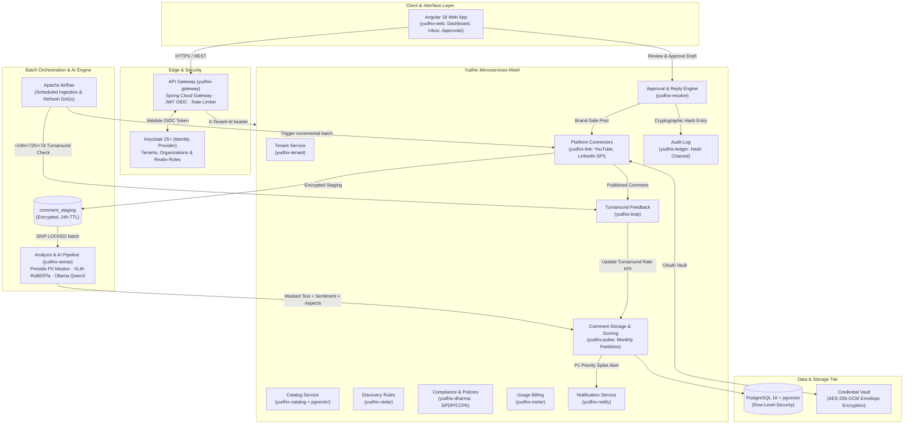

# Yudhix — Enterprise Social Comment Intelligence Platform

[](#)
[](#)
[](#)
[](#)
[](#)
[](#)
[](#)
[](#)
[](#)

---

## 1. Executive Overview & Guiding Principles

**Yudhix** is a multi-tenant, privacy-first, enterprise social comment intelligence and brand turnaround platform. It continuously harvests public comments about products from social platforms (YouTube, LinkedIn, Reddit, X), executes PII masking, extracts aspects and sentiment using local AI models (Ollama Qwen3 / XLM-RoBERTa), computes real-time impact scores, surfaces actionable insights, and orchestrates a compliant, human-in-the-loop reply turnaround workflow.

### Core Principles
- **Privacy by Design**: Store insights, not identities. Social author IDs are immediately hashed using keyed HMAC-SHA256 (`author_hash`). Personal PII is masked before model inference or long-term persistence.
- **Human-in-the-Loop**: No automated replies are ever posted without human approval (configurable 1- or 2-level approval with separation of duties).
- **Tenant Isolation**: Strict logical multi-tenancy backed by `tenant_id` on every row, Keycloak organization tokens, and PostgreSQL Row-Level Security (RLS).
- **Config over Code**: Discovery rules, SLA timers, impact weighting, and compliance policy packs (India DPDP 2023/2025, US CCPA/CPRA) are fully configuration-driven.

---

## 2. High-Level Architecture Diagram



---

## 3. End-to-End Working Flow: User Comment to Analytics & Reply

The lifecycle of a customer comment from initial creation on social media to impact calculation, human review, brand turnaround, and executive analytics:

```mermaid
sequenceDiagram
    autonumber
    actor Customer as Social Media User (YouTube / LinkedIn)
    participant Platform as Social Platform API (YouTube/LinkedIn)
    participant Airflow as Apache Airflow DAGs
    participant Link as yudhix-link (Connectors)
    participant Staging as comment_staging (Postgres)
    participant Sense as yudhix-sense (Python AI Engine)
    participant Ollama as Ollama LLM (Qwen3:8b)
    participant Pulse as yudhix-pulse (Scoring & Aggregates)
    participant Notify as yudhix-notify (Alerting)
    actor Agent as Support Agent (yudhix-web)
    actor Approver as Brand Manager / Approver
    participant Resolve as yudhix-resolve (Reply Workflow)
    participant Ledger as yudhix-ledger (Audit Trail)
    participant Loop as yudhix-loop (Turnaround Tracker)

    %% 1. Ingestion
    Customer->>Platform: Posts comment ("PS5 controller battery dies in 2 hours! #fail")
    Airflow->>Link: Triggers scheduled fetch task (every 15 min / cron)
    Link->>Platform: Incremental fetchComments(since Watermark)
    Platform-->>Link: Returns raw comment, platformAuthorId, likes, replies
    Note over Link: Keyed Pseudonymization:<br/>author_hash = HMAC-SHA256(tenant_key, author_id)
    Link->>Staging: Inserts to comment_staging (encrypted text, 24h TTL)

    %% 2. Sanitization & AI Processing
    Staging->>Sense: Batch worker pulls unanalyzed staging rows
    Note over Sense: Step 1: PII Masking (Microsoft Presidio)<br/>Masks names, phones, emails, order IDs, Aadhaar
    Note over Sense: Step 2: Fast Sentiment (XLM-RoBERTa)<br/>Result: NEGATIVE (-0.84)
    Sense->>Ollama: Step 3: Deep LLM Aspect & Intent Extraction (JSON Schema)
    Ollama-->>Sense: Aspects: [battery: NEGATIVE], Intent: COMPLAINT, ChurnRisk: 0.75<br/>Suggested Reply: "We're sorry! Try updating firmware or contact..."

    %% 3. Scoring & Storage
    Sense->>Pulse: Transfers sanitized comment + sentiment + aspects + reply draft
    Note over Pulse: Computes Impact Score (0-100):<br/>Severity x (Likes + Replies + Velocity) x Recency<br/>Priority: P1 (Score: 86 >= 80)
    Pulse->>Pulse: Upserts to monthly partitioned `comment` & `comment_analysis`
    Pulse->>Notify: Emits Crisis / P1 Notification Event
    Notify-->>Agent: Sends Slack / Email Alert (2-hour SLA response countdown)

    %% 4. Human-in-the-Loop Review
    Agent->>Pulse: Views prioritized comment in yudhix-web Agent Inbox
    Agent->>Resolve: Opens AI Draft, refines response template, submits for review
    Note over Resolve: Status: DRAFT -> IN_REVIEW<br/>(Enforces separation of duties)
    Approver->>Resolve: Reviews diff in Approval Drawer and approves
    Note over Resolve: Status: APPROVED

    %% 5. Posting & Tamper-Evident Audit
    Resolve->>Link: Dispatches authorized post request
    Link->>Platform: API Call: postReply(parentId, replyText)
    Platform-->>Link: Success: returns platformReplyId
    Note over Resolve: Status: POSTED
    Resolve->>Ledger: Appends audit event
    Note over Ledger: SHA-256 Hash Chain:<br/>row_hash = SHA-256(prev_hash || tenant_id || action || payload)

    %% 6. Feedback & Turnaround Outcome Loop
    Loop->>Airflow: Scheduled outcome checkpoints (+24h, +72h, +7d)
    Airflow->>Link: Re-fetch original comment thread engagement & customer replies
    Link-->>Loop: Returns follow-up comments & sentiment delta
    Note over Loop: Evaluates Outcome:<br/>Customer: "Thanks for the quick help, working now!"<br/>Result: IMPROVED (Turnaround Success)
    Loop->>Pulse: Records turnaround outcome in daily_product_sentiment
    Agent->>Pulse: Views executive dashboard (Turnaround Rate KPI & Aspect Heatmap)
```

---

## 4. Microservices Catalog & Responsibilities

| # | Service Directory | Service Name | Tech Stack | Responsibility | Owned Tables |
|---|---|---|---|---|---|
| 1 | `services/yudhix-gateway` | **yudhix-gateway** | Spring Cloud Gateway, Java 21 | OIDC token validation, tenant route isolation, rate-limiting, CORS | *Stateless* |
| 2 | `services/yudhix-tenant` | **yudhix-tenant** | Spring Boot 3.3, Java 21 | Tenant lifecycle, settings, Keycloak org sync, multi-country configuration | `tenant`, `tenant_setting`, `tenant_user` |
| 3 | `services/yudhix-catalog` | **yudhix-catalog** | Spring Boot 3.3, Java 21, pgvector | Product catalog, aliases, competitor tracking, embeddings (bge-m3) | `product`, `product_alias`, `owned_source` |
| 4 | `services/yudhix-radar` | **yudhix-radar** | Spring Boot 3.3, Java 21 | Topic taxonomy, discovery keyword rules, sentiment & engagement filters | `discovery_rule`, `topic` |
| 5 | `services/yudhix-link` | **yudhix-link** | Spring Boot 3.3, Java 21 | Platform SPI, OAuth token vault (AES-256-GCM), watermarks, fetch & post | `platform_credential`, `source_watermark`, `comment_staging` |
| 6 | `services/yudhix-sense` | **yudhix-sense** | Python 3.11, FastAPI, Presidio | PII sanitization, fast XLM-RoBERTa classifier, Ollama LLM aspect extraction | `comment_analysis`, `comment_aspect` |
| 7 | `services/yudhix-pulse` | **yudhix-pulse** | Spring Boot 3.3, Java 21, pg_partman | Monthly partitioned comments, velocity & engagement decay, P1/P2/P3 scoring | `comment`, `daily_product_sentiment` |
| 8 | `services/yudhix-resolve` | **yudhix-resolve** | Spring Boot 3.3, Java 21 | Reply state machine (DRAFT → IN_REVIEW → APPROVED → POSTED), SLA, brand voice | `reply`, `reply_template`, `approval_step` |
| 9 | `services/yudhix-loop` | **yudhix-loop** | Spring Boot 3.3, Java 21 | +24h/+72h/+7d thread turnaround outcome measurement, agent label feedback | `reply_outcome`, `label_feedback` |
| 10 | `services/yudhix-ledger` | **yudhix-ledger** | Spring Boot 3.3, Java 21 | Append-only, SHA-256 cryptographic hash-chained audit logging, verification | `audit_event` |
| 11 | `services/yudhix-dharma` | **yudhix-dharma** | Spring Boot 3.3, Java 21 | Policy packs (DPDP 2023, CCPA), cryptographic consent records, DSR execution | `policy_document`, `consent_record`, `retention_policy`, `dsr_request` |
| 12 | `services/yudhix-meter` | **yudhix-meter** | Spring Boot 3.3, Java 21 | Idempotent usage events, plan quotas, Stripe/Razorpay invoicing, GST & US tax | `usage_event`, `plan`, `subscription`, `invoice` |
| 13 | `services/yudhix-notify` | **yudhix-notify** | Spring Boot 3.3, Java 21 | Crisis spike alerts, SLA warnings, email (Mailpit/SMTP) & Slack dispatch | `notification` |
| 14 | `services/yudhix-config` | **yudhix-config** | Spring Cloud Config | Centralized Git/file-backed application properties & tenant config profiles | *Config Store* |

### Shared Modules & Frontend
- **`libs/yudhix-common`**: Shared tenant context (`TenantContextHolder`), PostgreSQL RLS interceptors, keyed `AuthorHasher`, standard API responses (`ApiResponse<T>`, `ErrorResponse`).
- **`libs/yudhix-connector-sdk`**: Pluggable `PlatformConnector` Java SPI, `FetchRequest`, `FetchResult`, `PostResult`, `EngagementSnapshot`, `Watermark`.
- **`frontend/yudhix-web`**: Angular 18+ application with standalone components, Signals, Keycloak OIDC, and ECharts analytics.

---

## 5. Privacy, Pseudonymization & Data Lifecycle

```
[Raw Social Comment]
       │
       ▼
[Keyed HMAC-SHA256] ──► author_hash = v1.<Base64Url(HMAC(tenant_key, platform + ":" + author_id))>
       │
       ▼
[Microsoft Presidio] ──► Masks PII: <PERSON>, <PHONE>, <EMAIL>, <ORDER_ID>, <GOV_ID>
       │
       ▼
[Only Masked Text] ──► Passed to AI Models & Persisted in Monthly Partitioned DB
       │
       ▼
[Retention Policy] ──► Staging TTL: 24 Hours | Masked Text Nullified: 30 Days | Aggregates: Long-term
```

1. **Author Pseudonymization**: Rather than plain SHA-256 (which is vulnerable to dictionary attacks on public channel IDs), Yudhix uses per-tenant HMAC keys. The same person commenting on two different tenant products generates completely independent hashes.
2. **Short-Lived Staging (24h TTL)**: Raw text exists only in-memory or in an encrypted staging partition with a 24-hour time-to-live before PII scrubbing.
3. **Data Minimization & Expiration**: Masked comment text is retained for $\le 30$ days (satisfying YouTube API Developer Policies) and then set to `NULL`. Statistical aggregates (`daily_product_sentiment`) remain indefinitely for historical business intelligence.

---

## 6. Repository Directory Structure

```
yudhix/
├── pom.xml                               # Root Multi-Module Maven POM
├── mvnw / mvnw.cmd                       # Maven Wrapper Executables
├── docker-compose.yml                    # Containerized Local Dev Stack
├── README.md                             # Platform Architecture & Working Flow
├── .gitignore                            # Root Project Git Ignore
├── db/
│   └── init/
│       ├── 01-init-databases.sql         # Database provisioning (yudhix, keycloak, airflow)
│       └── 02-enable-extensions.sql      # Extensions: uuid-ossp, pgcrypto, vector
├── keycloak/
│   └── realm-yudhix.json                 # Pre-configured Realm, Clients, and Roles
├── secrets/                              # Docker secrets (git-ignored)
│   ├── pg_password.txt
│   ├── kc_admin_password.txt
│   └── master_key.txt
├── airflow/
│   └── dags/                             # Airflow Batch & Turnaround DAGs
├── libs/
│   ├── yudhix-common/                    # Shared Context, RLS, HMAC Hasher, DTOs
│   └── yudhix-connector-sdk/             # Platform Connector Java SPI
├── services/                             # Microservices Ecosystem
│   ├── yudhix-gateway/
│   ├── yudhix-tenant/
│   ├── yudhix-catalog/
│   ├── yudhix-radar/
│   ├── yudhix-link/
│   ├── yudhix-sense/
│   ├── yudhix-pulse/
│   ├── yudhix-resolve/
│   ├── yudhix-loop/
│   ├── yudhix-ledger/
│   ├── yudhix-dharma/
│   ├── yudhix-meter/
│   ├── yudhix-notify/
│   └── yudhix-config/
└── frontend/
    └── yudhix-web/                       # Angular 18 Single Page App
```

---

## 7. Getting Started (Local Development)

### Prerequisites
- **Java 21** (Temurin 21 recommended)
- **Maven 3.9+** (or use included `./mvnw`)
- **Docker & Docker Compose**
- **Python 3.11** (for `yudhix-sense`)
- **Node.js 20+ & npm** (for `yudhix-web`)

### Build Shared Modules
```bash
./mvnw clean install
```

### Start Core Infrastructure
```bash
docker compose up -d postgres keycloak ollama mailpit
```
- **PostgreSQL**: `localhost:5432` (Database: `yudhix`, User: `yudhix`)
- **Keycloak Admin Console**: `http://localhost:8180` (User: `admin`)
- **Mailpit Web UI**: `http://localhost:8025`
- **Ollama AI Server**: `http://localhost:11434`
